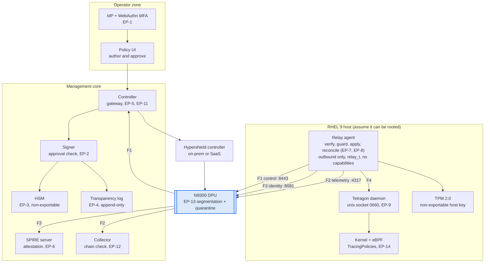
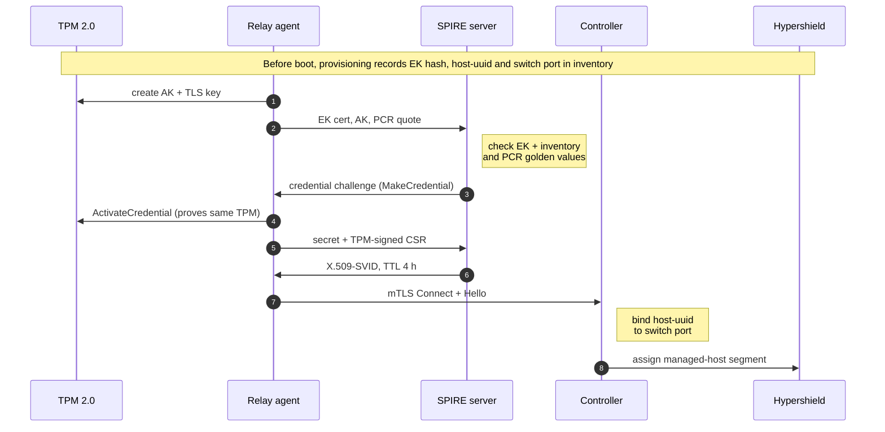
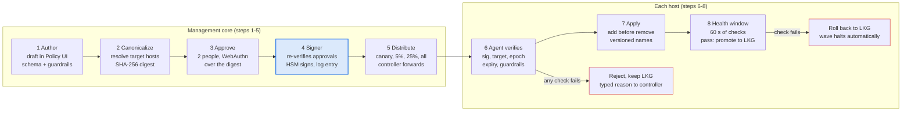
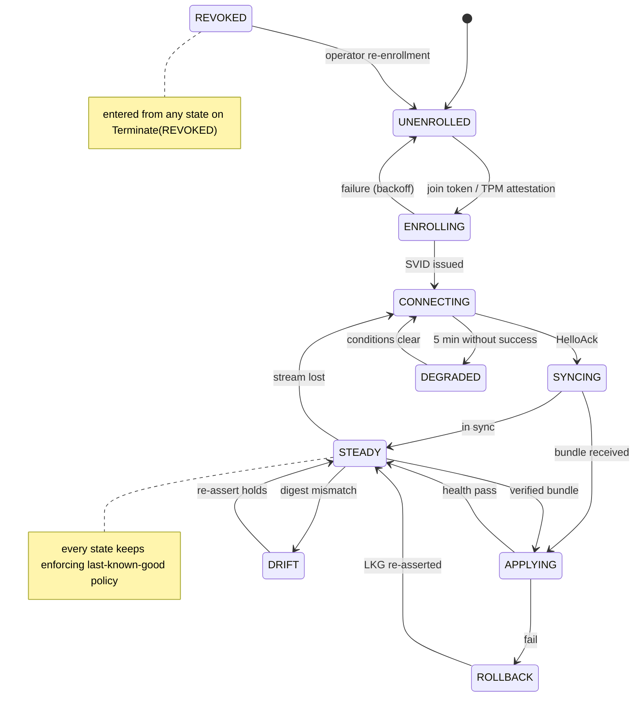
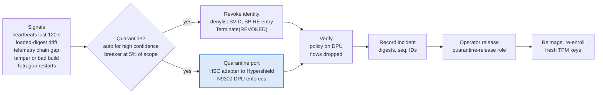

# Secure Management Plane for Tetragon on RHEL 9 — Security Architecture

Version 1.0 · Nov 21, 2026

## 1. Scope, audience and assumptions

This paper specifies how a central management plane securely pushes Tetragon TracingPolicies to RHEL 9 hosts and receives their security telemetry, with a Cisco N9300 Smart Switch as top-of-rack enforcer. It covers identity, transport, policy integrity, the on-host relay agent, host hardening, telemetry integrity and network containment. The policy-authoring UI already exists and is out of scope except where it must call security services.

**Audience:** platform, security and kernel engineers who will implement, review or attack this design. Familiarity with eBPF, Tetragon TracingPolicy semantics, X.509/mTLS, gRPC and SELinux is assumed.

### 1.1 In scope

- Host identity, enrollment, certificate rotation and revocation
- The controller-to-host control channel and its protocol
- Policy supply chain: approval, signing, distribution, verification, apply and rollback
- The relay agent: full functional and hardening specification
- Tetragon daemon hardening on RHEL 9
- Telemetry collection, integrity and separation from control
- N9300 Smart Switch / Hypershield segmentation and quarantine integration
- Threat model, enforcement-point matrix, failure modes and operational procedures

### 1.2 Out of scope

- UI implementation details (only its authN/authZ hooks are specified)
- Detection content (which TracingPolicies to write)
- SIEM correlation logic and analytics storage sizing
- Kubernetes deployments of Tetragon

### 1.3 Assumptions

| ID | Assumption | Impact if false |
| --- | --- | --- |
| A1 | Hosts run RHEL 9.4 or later with BTF available and Tetragon installed from the upstream RPM/tarball or Isovalent Enterprise build | Kernel feature validation (Section 15) must be redone |
| A2 | Hosts have TPM 2.0 (physical or vTPM) | Fall back to IdM/certmonger identity (Section 5.3); weaker key protection |
| A3 | Each host's data-plane NIC is cabled to an N9300 Smart Switch port with Hypershield enabled | Network containment (Section 11) unavailable; host compromise becomes unbounded |
| A4 | An internal PKI (IdM/FreeIPA or SPIRE) and an HSM or Vault Transit are available | Signing keys and CA keys need an alternative protected store |
| A5 | Controller, signer and collector run on a hardened management segment the hosts cannot reach except on published ports | Section 11 flow table must be adapted |
| A6 | Time is synchronized (chrony, authenticated NTS preferred) to within 5 s | Short-lived certificates and policy expiry checks fail open or closed incorrectly |

### 1.4 Terminology

| Term | Meaning |
| --- | --- |
| Controller | Central service that holds inventory, assignments and desired state, and terminates agent control streams |
| Signer | Isolated service holding the policy-signing key; signs only approved bundles |
| Relay agent (agent) | Process on each host; the only client of the local Tetragon gRPC socket and the only path between host and management plane |
| Policy bundle | Signed envelope containing one or more TracingPolicy YAML documents plus targeting and anti-replay metadata |
| Epoch | Monotonically increasing integer assigned to every bundle per target scope |
| Last-known-good (LKG) | The most recent bundle that verified, applied and passed health checks on a host |
| Hypershield controller (HSC) | Cisco's management plane for Hypershield enforcement on the N9300 DPU |
| Enforcement point (EP) | Any component that can independently deny an action |

## 2. Summary and design principles

The Tetragon gRPC API is root-equivalent: any client that can call `AddTracingPolicy` can kill arbitrary processes or override syscall return values on that host. The architecture therefore never exposes that API off-host, makes a single hardened relay agent its only caller, and requires every policy to carry a signature from a key that the network-facing controller does not hold. A host-independent enforcer, the N9300 DPU, bounds what a fully compromised host can reach and can quarantine it on controller command.

The design has five layers, each of which must be defeated independently:

1. **Host-local lockdown.** Tetragon listens only on a unix socket; the relay agent is the only principal permitted to connect (DAC + SELinux).
2. **Hardware-rooted identity and mTLS.** Each host holds a TPM-resident key and a short-lived X.509-SVID. The agent dials out over mutually authenticated TLS 1.3; hosts expose no listening management port.
3. **Policy supply chain integrity.** Bundles are approved by two people, signed by an isolated signer (HSM-backed), and verified by the agent against a pinned trust root, with target binding, epoch and expiry checks.
4. **Telemetry separation and integrity.** Telemetry is a one-way, hash-chained stream to a collector that has no ability to send control messages.
5. **Network enforcement outside the host's trust domain.** The N9300 DPU enforces stateful L3/L4 segmentation per switch port and executes quarantine when the controller loses trust in a host.

### 2.1 Design principles

| # | Principle | How it shows up |
| --- | --- | --- |
| P1 | No remote root-equivalent APIs | Tetragon gRPC bound to `unix:///var/run/tetragon/tetragon.sock`; the agent exposes no listener |
| P2 | Separate delivery authority from policy authority | Controller delivers; only the signer can authorize. Controller compromise cannot produce a valid policy |
| P3 | Outbound-only from hosts | Agent initiates all connections; inbound to hosts on the management segment is denied at the switch |
| P4 | Short-lived, hardware-bound credentials | SVID TTL 1 h to 24 h; private key non-exportable in the TPM |
| P5 | Fail safe, not fail open | Disconnected agents keep enforcing LKG; switch keeps enforcing last policy; unverifiable bundles are rejected |
| P6 | Assume the host can be rooted | Detection of policy drift and silence; containment enforced by the DPU, not by the host |
| P7 | Closed command set | The agent implements a fixed list of operations; there is no remote exec, shell or file-write primitive |
| P8 | Everything is attributable | Every policy carries author, approver, signer key ID and epoch; every apply is logged locally and centrally |
| P9 | Least privilege per component | Agent runs unprivileged with only socket access; each server component has its own identity and network scope |

## 3. System context and components

The system spans four trust zones: the operator zone (UI and approvers), the management core (controller, signer, PKI, collector), the host (agent, Tetragon, kernel) and the network fabric (N9300 and its Hypershield controller). Every cross-zone call is mutually authenticated, and only two kinds of traffic cross from host to management core: the control stream and the telemetry stream.

*Figure: system context · 4 trust zones, 14 enforcement points*



Subgraphs are trust zones; the highlighted DPU is the only enforcer outside the host's control. Arrows point from initiator to responder: every host flow is outbound and passes the DPU before reaching the management core.

### 3.1 Component inventory

| Component | Zone | Runs as / where | Identity | Talks to | Holds secrets |
| --- | --- | --- | --- | --- | --- |
| Policy UI (existing) | Operator | Web app behind SSO | OIDC client; users via IdP + phishing-resistant MFA | Controller API | Session tokens only |
| Controller API | Mgmt core | Container or VM, HA pair | SVID `spiffe://<td>/mgmt/controller` | UI, Signer, agents, HSC API, DB | TLS key (TPM/HSM-backed) |
| Controller stream gateway | Mgmt core | Same service, separate listener `:8443` | Same SVID; serving cert from controller CA | Agents (inbound) | TLS key |
| Signer | Mgmt core, isolated subnet | Minimal VM, no inbound except from Controller on one port | SVID `.../mgmt/signer` | HSM / Vault Transit, Controller | Access to signing key handle (key never leaves HSM) |
| Approval service | Mgmt core | Part of controller, separate RBAC domain | n/a | UI, Signer | n/a |
| SPIRE server (or IdM CA) | Mgmt core | HA pair, upstream CA in HSM | Root of host identity | Agents (node API), Controller | CA signing key (HSM) |
| Telemetry collector | Mgmt core | OTel Collector cluster, `:4317` | SVID `.../mgmt/collector` | Agents (inbound OTLP), SIEM / store | TLS key |
| Inventory / state DB | Mgmt core | PostgreSQL with TLS, row-level audit | DB role per service | Controller | n/a |
| Relay agent | Host | systemd service, user `tetragon-relay` | X.509-SVID `.../host/<host-uuid>`, TPM key | Controller, collector, local Tetragon socket | TPM key handle, trust root, LKG store |
| Tetragon daemon | Host | systemd service, root (CAP\_BPF, CAP\_PERFMON, CAP\_SYS\_ADMIN as required) | n/a (local only) | Kernel, unix socket | None |
| N9300 Smart Switch | Fabric | NX-OS + DPUs running Hypershield enforcer | Device identity enrolled to HSC | HSC | Device keys |
| Hypershield controller (HSC) | Fabric mgmt | On-prem or Security Cloud Control SaaS | Cisco-managed | N9300, Controller (API client) | API credentials |

### 3.2 Ports and protocols

| Flow | Initiator → responder | Port / proto | AuthN | Purpose |
| --- | --- | --- | --- | --- |
| F1 | Agent → Stream gateway | TCP 8443, gRPC over TLS 1.3 (h2) | mTLS, X.509-SVID both sides | Control stream (bidirectional over one client-initiated stream) |
| F2 | Agent → Collector | TCP 4317, OTLP/gRPC over TLS 1.3 | mTLS | Telemetry (client-streaming only) |
| F3 | Agent → SPIRE server | TCP 8081, gRPC/TLS | Node attestation, then SVID | Enrollment and SVID renewal |
| F4 | Agent → Tetragon | unix socket `/var/run/tetragon/tetragon.sock` | SO\_PEERCRED + DAC + SELinux | Policy CRUD, health, events |
| F5 | UI → Controller API | TCP 443, HTTPS | OIDC bearer + mTLS (service) | Authoring, approval, rollout |
| F6 | Controller → Signer | TCP 9443, gRPC/mTLS | SVID; Signer allowlists Controller ID | Sign approved bundle digests |
| F7 | Controller → HSC | HTTPS (vendor API) | API credential in Vault, scoped | Segment assignment, quarantine |
| F8 | Host → NTP | UDP 123 / NTS TCP 4460 | NTS (preferred) | Time for cert and expiry validation |

## 4. Trust model

The signing key and the TPM-resident host keys are the two roots everything else depends on; the controller is deliberately not trusted to authorize policy. The model assumes any single component, including the controller or one host, can be fully compromised, and asks that no single compromise lets an attacker push policy fleet-wide or silently blind the fleet.

### 4.1 Assets

| ID | Asset | Why it matters | Confidentiality | Integrity | Availability |
| --- | --- | --- | --- | --- | --- |
| AS1 | Policy-signing private key | Authorizes code-like changes to every host kernel | Critical | Critical | Medium |
| AS2 | Trust root metadata on hosts (pinned signer keys) | Defines what the agent will accept | Low | Critical | High |
| AS3 | Host private keys (TPM) | Host identity; stolen key = impersonation | Critical | Critical | Medium |
| AS4 | Identity CA keys (SPIRE upstream / IdM) | Mint any host or service identity | Critical | Critical | High |
| AS5 | Tetragon gRPC socket | Root-equivalent control of the host | n/a | Critical | High |
| AS6 | Loaded TracingPolicies (kernel state) | The actual enforcement | Low | Critical | Critical |
| AS7 | Telemetry stream | Detection, forensics; may contain secrets in process args | High | High | High |
| AS8 | Desired-state DB and audit log | Source of truth and accountability | Medium | Critical | High |
| AS9 | HSC API credential | Can re-segment or quarantine fabric ports | High | Critical | Medium |
| AS10 | Operator accounts (author, approver, deployer) | Initiate policy changes | High | Critical | Medium |

### 4.2 Adversaries

| ID | Adversary | Starting position | Goal |
| --- | --- | --- | --- |
| ADV1 | External attacker with foothold on one host (unprivileged) | Shell as an app user | Escalate, disable Tetragon, move laterally |
| ADV2 | Attacker with root on one host | Full host control | Blind detection, impersonate other hosts, pivot to management plane |
| ADV3 | Network attacker on management segment | L2/L3 adjacency | MITM, replay, DoS the control stream |
| ADV4 | Compromised controller | Code exec on controller | Push malicious policy fleet-wide, suppress quarantine |
| ADV5 | Malicious or phished operator | Valid UI account | Push destructive or detection-blinding policy |
| ADV6 | Compromised collector or SIEM | Code exec on collector | Read sensitive telemetry, attempt to reach agents |
| ADV7 | Supply-chain attacker | Tampered agent or Tetragon build | Persistent backdoor on every host |

### 4.3 Trust boundaries

| Boundary | Crossing | Enforced by |
| --- | --- | --- |
| TB1 Operator → Mgmt core | UI → Controller API | IdP + MFA, RBAC, two-person approval |
| TB2 Controller → Signer | Sign request | mTLS + caller allowlist, approval proof verified by Signer, HSM policy |
| TB3 Mgmt core → Host | Control stream | mTLS, bundle signature verification by agent |
| TB4 Host process → Tetragon | Socket call | Socket DAC, SO\_PEERCRED check, SELinux type enforcement |
| TB5 Host → Network | Any packet leaving the port | N9300 DPU stateful policy |
| TB6 Mgmt core → Fabric | Controller → HSC | Scoped API credential, rate limit, change logging |

### 4.4 Security invariants

These must hold under the stated adversaries; each is traced to controls in Section 12 and tested in Section 15.

- **INV-1** No TracingPolicy is loaded on any host unless it carries a valid signature chaining to the host's pinned trust root, is targeted at that host, has an epoch greater than the host's current epoch, and is unexpired.
- **INV-2** No process other than the relay agent (and break-glass root, which is logged) can call the Tetragon gRPC API.
- **INV-3** A host never accepts an inbound management connection.
- **INV-4** The controller cannot produce a signature the agent accepts (ADV4 cannot satisfy INV-1).
- **INV-5** A host that stops reporting, or reports a loaded-policy digest that differs from desired state, is quarantined at the switch within a bounded time T\_q (target 120 s).
- **INV-6** The collector has no network path or protocol primitive to send data to an agent.
- **INV-7** One host's credential cannot be used from another switch port (credential binding to port, Section 11.4).

## 5. Identity and PKI

Every host proves its identity with a TPM-resident key and receives a short-lived X.509-SVID; the recommended issuer is SPIRE with TPM node attestation, and IdM/FreeIPA with certmonger is the supported fallback. Two separate trust domains are kept: the **identity PKI** (who is talking) and the **policy trust root** (what may be loaded). Compromise of one does not grant the other.

### 5.1 Identity format

- SPIFFE trust domain: `spiffe://mgmt.<customer>.internal`
- Host SVID: `spiffe://mgmt.<customer>.internal/host/<host-uuid>`, where `host-uuid` is assigned at inventory registration, never derived from hostname (hostnames are attacker-settable post-compromise)
- Service SVIDs: `/mgmt/controller`, `/mgmt/signer`, `/mgmt/collector`, `/mgmt/hsc-adapter`
- Certificate profile: ECDSA P-384 (FIPS 186-4/5 approved), `digitalSignature` only, EKU `clientAuth` for hosts, `serverAuth`+`clientAuth` for services, URI SAN carries the SPIFFE ID, no DNS SAN for hosts
- TTL: hosts 4 h (renew at 50%), services 24 h. Upstream intermediate 30 days, root offline 10 years in HSM

### 5.2 Recommended: SPIRE with TPM node attestation

The host's Endorsement Key (EK) certificate, issued by the TPM vendor, anchors the attestation. The SPIRE agent function is embedded in the relay agent (or the stock `spire-agent` runs beside it and exposes the Workload API only to the relay's UID).

*Figure: host enrollment sequence · 8 messages*



Step 4 is the proof: only the TPM holding the enrolled EK can decrypt the challenge, which binds the attestation key, and therefore the TLS key, to that physical or virtual TPM.

Enrollment steps:

1. **Pre-registration.** At provisioning (Satellite/kickstart), the EK public key hash and serial are recorded in inventory against the `host-uuid` and expected switch port (from cabling DB / LLDP). Optionally a one-time join token (TTL 1 h, single use) is issued for hosts without EK certificates.
2. **Key creation.** The agent creates an Attestation Key (AK) under the TPM Endorsement hierarchy and a separate non-exportable signing key for TLS (`TPM2_Create` with `fixedTPM | fixedParent | sensitiveDataOrigin`, no `decrypt`).
3. **Attestation.** Agent sends EK cert, AK public, and a PCR quote (PCRs 0,2,4,7 for firmware/boot/Secure Boot state, optionally 8–9 for kernel/initrd via IMA-aware measured boot) to the SPIRE server over TLS (server-auth only at this point).
4. **Credential activation.** Server verifies EK chain to the TPM vendor CA, checks the EK hash against inventory, and issues a `MakeCredential` challenge encrypted to the EK; only the real TPM can `ActivateCredential`. This proves AK and EK are in the same TPM.
5. **Policy check.** Server verifies the PCR quote against the golden values for that host class. A mismatch blocks issuance and raises an alert (possible bootkit or unapproved kernel).
6. **SVID issuance.** Server issues the X.509-SVID for the TLS key (CSR signed by that TPM key). The private key never leaves the TPM.
7. **Port binding.** Controller records `(host-uuid, SVID serial, switch, port, MAC)` at first connection and instructs HSC to place the port in the `managed-host` segment (Section 11).

### 5.3 Fallback: IdM/FreeIPA with certmonger

- Host enrolled with `ipa-client-install` using a one-time password (OTP) generated by the provisioning pipeline
- certmonger requests a certificate from a dedicated IdM certificate profile (`relayAgentHost`) with the SPIFFE URI SAN, 7-day validity, auto-renew at 2 days remaining
- Private key stored via PKCS#11 on the TPM (`tpm2-pkcs11`) where available; otherwise a file key at `0400 tetragon-relay` with SELinux label `relay_key_t`
- Weaknesses vs SPIRE/TPM: no boot-state attestation, longer TTL, revocation depends on CRL/OCSP distribution

### 5.4 Rotation

- SVID renewal is driven by the agent at 50% of TTL over the existing authenticated session; the new key is a fresh TPM key (key rotation, not just certificate rotation) every 7 days
- If renewal fails, the agent retries with exponential backoff (base 10 s, cap 5 min, full jitter) and enters `DEGRADED` when the certificate has under 15 minutes left. LKG enforcement continues; only connectivity is lost
- Service certificates rotate via SPIRE Workload API; the controller hot-reloads its listener certificate without dropping streams
- Controller serving CA bundle is distributed to agents via SPIRE federation bundle updates, never via the control stream itself

### 5.5 Revocation

Short TTL is the primary revocation mechanism. Immediate revocation uses three layers:

| Layer | Mechanism | Latency |
| --- | --- | --- |
| Session | Controller denylist checked on every stream open and every 60 s on live streams; controller sends `Terminate` and closes | < 60 s |
| Identity | SPIRE entry deleted; no renewal possible | ≤ TTL (4 h) |
| Network | HSC moves the host's port to `quarantine` segment | Seconds (validate with Cisco, Section 15) |

### 5.6 Key hierarchy

| Key | Algorithm | Storage | Custodian | Rotation |
| --- | --- | --- | --- | --- |
| Identity root CA | ECDSA P-384 | Offline HSM, M-of-N (3 of 5) | Security officers | 10 y, ceremony |
| SPIRE upstream intermediate | ECDSA P-384 | Online HSM | SPIRE server | 30 d, automated |
| Host TLS key | ECDSA P-384 | Host TPM, non-exportable | Agent | 7 d |
| Policy root key(s) | ECDSA P-384 | Offline HSM, 2-of-3 threshold | Security officers | 3 y, ceremony |
| Policy signing key | ECDSA P-384 | Online HSM / Vault Transit, non-exportable | Signer | 90 d, delegated by root metadata |
| HSC API credential | Vendor-defined | Vault, leased to hsc-adapter | Controller | 30 d or per vendor |

## 6. Control channel

The control channel is one long-lived, agent-initiated gRPC bidirectional stream over mTLS 1.3. The controller can push bundles down it, but the message set is closed: the agent can be asked to apply a signed bundle, report state, or rotate credentials, and nothing else. Transport security proves who sent a message; it never substitutes for bundle signatures.

### 6.1 TLS profile

| Parameter | Value | Rationale |
| --- | --- | --- |
| Protocol | TLS 1.3 only | Removes renegotiation, static RSA, CBC suites |
| Cipher suites | `TLS_AES_256_GCM_SHA384`, `TLS_AES_128_GCM_SHA256` | FIPS-approved; align with RHEL `FIPS` crypto-policy |
| Groups | `secp384r1`, `secp256r1` (X25519 only if not in FIPS mode; hybrid ML-KEM when the RHEL crypto stack supports it in FIPS mode) | FIPS compliance; post-quantum readiness tracked |
| Client auth | Required; verify chain to SPIRE trust bundle; URI SAN must match `spiffe://<td>/host/*` | Mutual auth |
| Server auth | Agent verifies controller SVID `spiffe://<td>/mgmt/controller` exactly (SPIFFE ID pinning, not hostname) | Defeats CA mis-issuance for other names |
| 0-RTT | Disabled | Replay risk |
| Session resumption | Disabled for control stream | Each connection re-proves TPM key possession |
| ALPN | `h2` | gRPC |
| Keepalive | HTTP/2 PING every 30 s, timeout 10 s | Fast dead-peer detection |
| Limits | Max frame 1 MiB, max concurrent streams 1 per agent identity, header list 16 KiB | DoS resistance |

### 6.2 Service definition

```protobuf
syntax = "proto3";
package relay.control.v1;

service AgentControl {
  // Exactly one active stream per host identity. A second open from the same
  // SVID terminates the older stream and raises a duplicate-identity alert.
  rpc Connect(stream AgentMessage) returns (stream ControllerMessage);
}

message AgentMessage {
  uint64 seq = 1;                    // strictly increasing per stream
  oneof body {
    Hello        hello        = 10;
    Heartbeat    heartbeat    = 11;
    ApplyResult  apply_result = 12;
    StateReport  state_report = 13;
    Alert        alert        = 14;
  }
}

message ControllerMessage {
  uint64 seq = 1;
  oneof body {
    HelloAck       hello_ack       = 10;
    PolicyBundle   bundle          = 11;  // opaque signed envelope (Section 7)
    StateRequest   state_request   = 12;  // ask for full StateReport
    RotateIdentity rotate_identity = 13;  // trigger early key rotation
    TrustUpdate    trust_update    = 14;  // signed root metadata (Section 7.6)
    Terminate      terminate       = 15;  // reason code; agent backs off
  }
  // No exec, file write, shell, config-set, or debug messages exist by design.
}

message Hello {
  string host_uuid          = 1;
  string agent_version      = 2;
  string agent_build_digest = 3;  // sha256 of running binary (/proc/self/exe)
  string tetragon_version   = 4;  // from Tetragon GetVersion
  string kernel_release     = 5;
  string boot_id            = 6;  // /proc/sys/kernel/random/boot_id
  uint64 current_epoch      = 7;
  bytes  loaded_digest      = 8;  // see Section 6.4
  bytes  lkg_bundle_digest  = 9;
  bytes  trust_root_digest  = 10;
  uint64 trust_root_version = 11;
  bytes  pcr_quote          = 12; // optional TPM quote over nonce from HelloAck
}

message Heartbeat {
  uint64 current_epoch = 1;
  bytes  loaded_digest = 2;
  TetragonHealth health = 3;        // from GetHealth + process liveness
  uint64 telemetry_last_seq = 4;    // last telemetry batch seq shipped
  uint32 telemetry_backlog = 5;     // batches spooled, not acked
}

message ApplyResult {
  bytes  bundle_digest = 1;
  uint64 epoch         = 2;
  enum Status { APPLIED = 0; REJECTED_SIGNATURE = 1; REJECTED_TARGET = 2;
                REJECTED_EPOCH = 3; REJECTED_EXPIRED = 4; REJECTED_SCHEMA = 5;
                REJECTED_GUARDRAIL = 6; APPLY_FAILED = 7; ROLLED_BACK = 8; }
  Status status = 3;
  string detail = 4;               // bounded 4 KiB, no secrets
  bytes  loaded_digest_after = 5;
}
```

### 6.3 Session lifecycle

1. **Dial.** Agent resolves the controller VIP from local config (not DNS-only; config carries pinned IPs plus SPIFFE ID), opens TLS with its current SVID.
2. **Authorize.** Gateway extracts the SPIFFE ID, checks: chain valid, not on denylist, `host-uuid` exists in inventory, state not `decommissioned`, and source IP matches the host's recorded management IP. Any failure: TLS alert or immediate `Terminate`.
3. **Hello / HelloAck.** HelloAck carries a 32-byte nonce; if PCR re-attestation is enabled the agent returns a quote over the nonce in its next message.
4. **Reconcile.** Controller compares `current_epoch`, `loaded_digest` and `trust_root_version` against desired state. If behind, it sends the current signed bundle and any newer trust metadata. If `loaded_digest` disagrees with what the host's own epoch implies, that is drift (Section 10.4) and triggers the quarantine policy.
5. **Steady state.** Heartbeat every 15 s. Controller marks host `SILENT` after 3 missed heartbeats (45 s) and `LOST` after 120 s, at which point INV-5 quarantine applies.
6. **Termination.** Either side may close. The agent reconnects with full-jitter exponential backoff (1 s base, 5 min cap). `Terminate{reason=REVOKED}` causes the agent to stop reconnecting until its identity is re-issued.

### 6.4 Loaded-policy digest

The digest is computed by the agent from Tetragon's own view, not from the agent's store, so it reflects kernel reality:

1. Call `ListTracingPolicies` on the local socket.
2. For each policy, take `(name, namespace, state, enabled, sha256(canonical YAML))`. Canonical YAML = parsed and re-serialized with sorted keys, no comments.
3. Sort tuples by name, serialize with a length-prefixed encoding, SHA-256 the result.

The controller computes the expected digest from the bundle it believes is applied. Any difference means a policy was added, removed, disabled or modified outside the agent. Because Tetragon's response is what is hashed, an attacker who unloads a policy directly through the socket (requires root, ADV2) changes the digest at the next heartbeat; an attacker who also tampers with the agent can lie, which is why silence and drift are both quarantine triggers and why the switch, not the host, enforces the consequence.

### 6.5 Controller-side protections

- Per-identity rate limits: 1 stream, 10 messages/s, 64 KiB/s sustained
- Message size cap 1 MiB; bundles above 512 KiB rejected at authoring time
- `seq` gaps or regressions close the stream
- The controller only forwards bundles whose digest it has a Signer receipt for; it cannot construct envelopes (and the agent would reject them anyway)

## 7. Policy supply chain

A policy reaches a kernel only after two humans have bound their hardware credentials to its exact digest, an isolated signer has verified those approvals itself and signed with an HSM key, and the agent has verified signature, target, epoch, expiry, schema and guardrails. The controller sits in the middle of this pipeline but can neither forge approvals nor sign.

*Figure: policy supply chain · 8 steps, 2 failure exits*



The controller appears only at steps 2 and 5, where it computes and forwards; it never holds the authority (steps 3 and 4) or the final check (step 6).

### 7.1 Roles

| Role | Can | Cannot |
| --- | --- | --- |
| Author | Create and edit drafts in the UI, run validation and canary dry-runs | Approve own change, sign, deploy to production scope |
| Approver | Approve a specific bundle digest with a WebAuthn assertion | Approve a bundle they authored; edit after approval (any edit changes the digest and voids approvals) |
| Deployer | Choose rollout waves for signed bundles | Change bundle contents or targets |
| Security officer | Hold policy-root key shares; run key ceremonies | Act alone (2-of-3 threshold) |
| Break-glass | Emergency single-approver path for `monitor`-only policies, auto-expires 24 h, pages security | Push enforcement actions (`Sigkill`, `Override`) |

### 7.2 Pipeline

1. **Author.** UI produces one or more TracingPolicy documents. The controller validates them against the JSON Schema generated from the TracingPolicy CRD for the exact Tetragon version deployed, plus the guardrail rules (Section 7.5).
2. **Canonicalize.** YAML is parsed and re-serialized canonically. The bundle payload (Section 7.3) is built and its SHA-256 digest computed. This digest is what everyone approves.
3. **Approve.** Each approver's browser performs a WebAuthn `get()` where `challenge = SHA-256("relay-approval-v1" || bundle_digest)`. The resulting assertion (authenticatorData, clientDataJSON, signature, credential ID) is the approval proof. Two distinct approvers, neither the author, are required for any bundle containing `Sigkill`, `Override`, `Signal` or `NotifyEnforcer` actions; one approver for `Post`-only bundles.
4. **Sign request.** Controller sends the Signer `{payload, approvals[]}`.
5. **Signer verification.** The Signer independently re-computes the digest, verifies each WebAuthn assertion against its own approver credential registry (synced from the IdP via a separate, signed channel, not from the controller), checks role membership, author ≠ approver, approval age < 24 h, and scope limits (e.g. production fleet requires two approvers from the security group).
6. **Sign.** Signer creates a DSSE envelope and asks the HSM to sign the PAE (pre-authentication encoding). The HSM key is non-exportable; HSM policy limits signing rate (e.g. 60/h) to bound damage from a compromised Signer.
7. **Transparency.** Signer appends `(bundle_digest, key_id, epoch, targets, approvers, timestamp)` to an append-only log (e.g. a Trillian/Rekor-style Merkle log run internally). Agents may require an inclusion proof (Section 7.4 step 4).
8. **Distribute.** Controller pushes the envelope down control streams in waves: canary hosts → 5% → 25% → 100%, gated on `ApplyResult` and health telemetry.

### 7.3 Envelope format

```json
{
  "payloadType": "application/vnd.relay.policybundle.v1+json",
  "payload": "<base64 of canonical JSON below>",
  "signatures": [
    { "keyid": "sha256:4f1c...e9", "sig": "<base64 ECDSA-P384 over DSSE PAE>" }
  ]
}
```

Decoded payload:

```json
{
  "schema": "relay.policybundle.v1",
  "bundle_id": "pb-2026-11-21-0042",
  "epoch": 1842,
  "scope": "prod-db",
  "targets": {
    "host_uuids": ["9b2f...", "c01a..."],
    "selector_digest": "sha256:..."
  },
  "not_before": "2026-11-21T14:00:00Z",
  "expires": "2026-12-05T14:00:00Z",
  "tetragon_min_version": "1.3.0",
  "mode": "enforce",
  "policies": [
    { "name": "block-shadow-read", "version": 7,
      "sha256": "...", "yaml": "apiVersion: cilium.io/v1alpha1\nkind: TracingPolicy\n..." }
  ],
  "provenance": {
    "author": "jdoe@corp", "approvers": ["asmith@corp", "bkim@corp"],
    "change_ref": "CHG-118823", "controller_build": "sha256:..."
  }
}
```

Notes: `targets.host_uuids` is an explicit, resolved list (selectors are resolved before approval so approvers see exactly which hosts are affected). A bundle is always the **complete desired set** for its scope, not a delta, so the agent can compute removals and the digest is well-defined.

### 7.4 Agent verification algorithm

```text
verify(envelope, host, state, trust):
  1. size(envelope) <= 1 MiB                                  else REJECTED_SCHEMA
  2. payloadType == expected                                   else REJECTED_SCHEMA
  3. sig valid over PAE(payloadType, payload) under a key k
     where k in trust.targets_keys, k not expired, k not revoked,
     and threshold(trust.targets_role) satisfied               else REJECTED_SIGNATURE
  4. if trust.require_log_proof: verify inclusion proof
     against pinned log key                                    else REJECTED_SIGNATURE
  5. p = parse(payload) with strict decoder (no unknown fields,
     no duplicate keys, depth <= 32)                           else REJECTED_SCHEMA
  6. host.uuid in p.targets.host_uuids                         else REJECTED_TARGET
  7. p.scope in host.allowed_scopes (local config)             else REJECTED_TARGET
  8. p.epoch > state.current_epoch(p.scope)                    else REJECTED_EPOCH
  9. now >= p.not_before - skew and now < p.expires + skew     else REJECTED_EXPIRED
 10. tetragon_version >= p.tetragon_min_version                else REJECTED_SCHEMA
 11. for each policy: sha256(yaml) == declared sha256;
     validate against local CRD schema for running version     else REJECTED_SCHEMA
 12. guardrails(p.policies) pass (Section 7.5)                 else REJECTED_GUARDRAIL
  -> ACCEPT
```

Skew tolerance is 300 s. Verification uses only local state; it never calls the controller.

### 7.5 Agent-side guardrails

Guardrails are compiled into the agent and can only be relaxed by a trust-root-signed update, not by a policy bundle. They protect against approved-but-catastrophic policies:

- Deny any selector that can match PID 1, `systemd`, `sshd`, `tetragon`, the relay agent binary, `chronyd`, or the SPIRE agent with `Sigkill`, `Signal` or `Override`
- Deny `Override` on `security_bprm_check`-style hooks that would block all exec without a `matchBinaries` or `matchArgs` selector (no unscoped exec denial)
- Deny policies whose file selectors match `/var/run/tetragon/`, the agent's state directory, or `/etc/tetragon/` with enforcement actions
- Cap: ≤ 64 policies per bundle, ≤ 256 kprobes total, ≤ 4096 selector values (bounds BPF map and verifier load)
- Require `mode` per bundle; a scope's first bundle must be `monitor` (enforce only after at least one monitor epoch on the same policy names)

### 7.6 Trust root and key rotation

The pinned trust root follows The Update Framework (TUF) role model so signing keys can rotate without touching hosts by hand:

- **root** role: 2-of-3 offline keys (security officers, HSM-held). Signs the list of keys allowed for `targets` and `log`. Version-numbered; agents accept root N+1 only if signed by a threshold of root N **and** N+1 keys.
- **targets** role: the online policy-signing key(s). Threshold 1 by default, optionally 2 for production scopes with two independent HSMs.
- **log** role: transparency log public key.
- Root metadata has its own expiry (365 days). An agent with expired root metadata stops accepting new bundles (keeps LKG) and alerts.
- Initial root is installed by the agent RPM, whose own signature is verified by RPM/GPG during Satellite provisioning, and is measured into IMA.

### 7.7 Apply and rollback

Tetragon has no transactional multi-policy update, and replacing a policy is a remove-then-add. To avoid an enforcement gap, the agent applies **add-before-remove** using versioned names.

1. Persist the verified envelope to the staging slot of the LKG store (`fsync`).
2. Compute plan: for each policy, target name = `<name>-v<version>`. Additions = in bundle, not loaded. Removals = loaded with relay-managed label, not in bundle.
3. For each addition: `AddTracingPolicy{yaml}` with name rewritten to the versioned name. If `mode=monitor`, actions are rewritten to `Post` before load and the original kept for audit (or Tetragon's native policy mode is used where the deployed version supports it).
4. Confirm with `ListTracingPolicies` that every addition is `enabled` and in a loaded state; on any error, delete the additions just made and go to step 8.
5. For each removal: `DeleteTracingPolicy{name}`.
6. Write the verified YAML set to `/etc/tetragon/tetragon.tp.d/relay/` (so Tetragon reloads the same set on restart) and remove stale files, atomically via a temp directory and `rename`.
7. Health window (default 60 s): Tetragon `GetHealth` OK; agent can still reach the controller; critical units (`sshd`, `chronyd`, `tetragon`, `tetragon-relay`) active; no surge of Tetragon `process_kprobe` events with enforcement actions above a per-bundle threshold. Pass: promote staging to LKG, update epoch, report `APPLIED`.
8. Fail: re-apply LKG set using the same add-before-remove procedure, report `ROLLED_BACK` with detail. The controller halts the rollout wave automatically.

## 8. Relay agent specification

The relay agent is a single statically linked Go binary (`/usr/libexec/tetragon-relay/relayd`) that runs unprivileged, holds no Linux capabilities, and is the only bridge between the host's Tetragon socket and the management plane. It is a verifier and courier, not a general-purpose management agent: it has no shell, exec, file-transfer or arbitrary-config primitive.

### 8.1 Why Go

- **Tetragon is Go.** Its gRPC API definitions and generated Go client come from the same project, so the agent can talk to the Tetragon socket with the official code.
- **The rest of the stack is Go.** SPIRE is written in Go and has Go libraries for X.509-SVIDs. Google's `go-tpm` library is the standard way to use TPM keys as a signer for TLS. gRPC and OpenTelemetry both have first-class Go support.
- **Deployment is simple.** A single static binary has no runtime dependencies on RHEL 9, makes reproducible builds straightforward, and is easy to package as an RPM.
- **Memory safety.** That removes a whole class of bugs from code that parses data from the network.
- **FIPS has a path.** Go now has a native FIPS 140-3 crypto module, and Red Hat ships a Go toolset that uses RHEL's validated OpenSSL. Section 8.12 covers this.

### 8.2 Responsibilities

1. Establish and maintain host identity (TPM keys, SVID enrollment and renewal)
2. Maintain the single outbound control stream to the controller
3. Verify policy bundles and trust-root updates entirely locally
4. Apply, reconcile and roll back TracingPolicies through the local Tetragon socket
5. Persist last-known-good state and re-assert it after Tetragon or host restarts
6. Compute and report loaded-policy digests, health and version facts
7. Collect Tetragon events, redact, sequence, hash-chain, spool and ship them to the collector
8. Emit a tamper-evident local audit trail

### 8.3 Internal modules

| Module | Function | Inputs | Outputs | Security notes |
| --- | --- | --- | --- | --- |
| `identity` | TPM key lifecycle, SPIRE node attestation, SVID renewal, key rotation | `/dev/tpmrm0`, SPIRE server | In-memory `tls.Certificate` backed by TPM signer (`crypto.Signer` via go-tpm) | Private key never in process memory; only TPM handles |
| `control` | gRPC client, stream lifecycle, backoff, message dispatch | Identity, config | Typed events to `policy`, reports from `state` | Rejects unknown message types; enforces `seq` monotonicity |
| `trust` | TUF-style root/targets/log metadata, version and expiry checks | `TrustUpdate` messages, `/var/lib/tetragon-relay/trust/` | Current verification key set | Root rotation requires old+new threshold; never downgrades version |
| `verify` | Implements Section 7.4 algorithm | Envelope, trust, state | Accept or typed rejection | Strict decoders; constant-size limits; no network calls |
| `guard` | Compiled guardrails (Section 7.5) | Parsed TracingPolicies | Pass or rejection reason | Rules only relaxed by signed trust metadata |
| `apply` | Add-before-remove apply, health window, rollback | Verified bundle, Tetragon client | `ApplyResult`, LKG updates | Single-flight: one apply at a time, global mutex |
| `tetra` | Typed client for Tetragon `FineGuidanceSensors` gRPC over unix socket | Socket path | Add/Delete/List policies, GetHealth, GetVersion, GetEvents | Peer is checked: socket owner must be root, SELinux context `tetragon_var_run_t` |
| `store` | Crash-safe state: epoch, LKG and staging envelopes, digests | Filesystem | Durable state | Write-temp, `fsync`, `rename`, `fsync(dir)`; files HMAC'd with a TPM-sealed key |
| `reconcile` | Periodic (60 s) and event-driven comparison of Tetragon reality vs LKG | `tetra`, `store` | Re-apply or drift alert | Re-applies only LKG (signed); never invents state |
| `telemetry` | Event intake, redaction, batching, hash-chaining, spool, OTLP export | Tetragon `GetEvents` stream | OTLP batches to collector | Separate TLS connection and endpoint; client-streaming only |
| `audit` | Local append-only log of every security-relevant action | All modules | journald entries (Forward Secure Sealing enabled) plus central copy via telemetry | Structured, no secrets |
| `health` | Self-checks, watchdog, resource accounting | systemd, modules | `sd_notify` WATCHDOG, Heartbeat fields | Watchdog timeout 30 s |

### 8.4 State machine

*Figure: relay agent state machine · 10 states*



No state removes enforcement: losing the controller, identity or trust metadata only stops new changes. DRIFT and REVOKED raise an alert.

| State | Entered when | Behavior | Exits to |
| --- | --- | --- | --- |
| `UNENROLLED` | First boot, or identity revoked | No control stream. Enforces any RPM-shipped baseline policy only | `ENROLLING` on valid join token / TPM attestation path |
| `ENROLLING` | Attestation started | Talks only to SPIRE server | `CONNECTING` on SVID; `UNENROLLED` on failure (backoff) |
| `CONNECTING` | Valid SVID, no stream | Dial with backoff; LKG enforced | `SYNCING` on HelloAck; `DEGRADED` after 5 min without success |
| `SYNCING` | Stream up | Exchange Hello, receive reconcile bundle if behind | `APPLYING` if bundle received; `STEADY` if in sync |
| `STEADY` | In sync | Heartbeats, telemetry, reconcile loop | `APPLYING`, `CONNECTING` (stream lost), `DRIFT` |
| `APPLYING` | Verified bundle accepted | Apply + health window; control stream stays up | `STEADY` on success; `ROLLBACK` on failure |
| `ROLLBACK` | Apply or health failed | Re-assert LKG | `STEADY` (reports `ROLLED_BACK`) |
| `DRIFT` | Reconcile finds Tetragon state ≠ LKG | Alert immediately, re-assert LKG once, report both digests | `STEADY` if re-assert holds; stays `DRIFT` and alerts each cycle otherwise |
| `DEGRADED` | No controller for > 5 min, or cert < 15 min, or trust metadata expired | LKG enforced, telemetry spooled, reconnect continues | `CONNECTING` when conditions clear |
| `REVOKED` | `Terminate{REVOKED}` or cert rejected as revoked | Stop reconnecting; LKG enforced; local alert | `UNENROLLED` after operator re-enrollment |

### 8.5 Filesystem layout and permissions

| Path | Owner:group | Mode | SELinux type | Purpose |
| --- | --- | --- | --- | --- |
| `/usr/libexec/tetragon-relay/relayd` | root:root | 0755 | `relay_exec_t` | Binary (IMA-measured, RPM-signed) |
| `/etc/tetragon-relay/relay.yaml` | root:tetragon-relay | 0640 | `relay_conf_t` | Static config |
| `/etc/tetragon-relay/trust/root.json` | root:root | 0644 | `relay_conf_t` | Initial trust root shipped by RPM |
| `/var/lib/tetragon-relay/` | tetragon-relay:tetragon-relay | 0700 | `relay_var_lib_t` | State, LKG, staging, current trust metadata |
| `/var/spool/tetragon-relay/telemetry/` | tetragon-relay:tetragon-relay | 0700 | `relay_spool_t` | Bounded telemetry spool (default 2 GiB) |
| `/etc/tetragon/tetragon.tp.d/relay/` | root:tetragon-relay | 2770 | `relay_policy_t` | Verified policies persisted for Tetragon restart |
| `/var/run/tetragon/tetragon.sock` | root:tetragon-relay | 0660 | `tetragon_var_run_t` | Tetragon gRPC socket |
| `/dev/tpmrm0` | tss:tss | 0660 | `tpm_device_t` | TPM resource manager (agent is in group `tss`) |

### 8.6 Configuration (example)

```yaml
# /etc/tetragon-relay/relay.yaml
host:
  uuid_source: tpm-nv            # host-uuid sealed in TPM NV index at provisioning
  allowed_scopes: [prod-db]
controller:
  endpoints: ["10.20.0.10:8443", "10.20.0.11:8443"]
  spiffe_id: spiffe://mgmt.acme.internal/mgmt/controller
  heartbeat_interval: 15s
collector:
  endpoints: ["10.20.0.30:4317"]
  spiffe_id: spiffe://mgmt.acme.internal/mgmt/collector
  spool_max_bytes: 2147483648
  batch_max_events: 2000
  batch_max_age: 2s
identity:
  provider: spire                 # spire | idm
  spire_server: "10.20.0.20:8081"
  trust_bundle: /etc/tetragon-relay/trust/spire-bundle.pem
  key_rotation: 168h
tetragon:
  socket: unix:///var/run/tetragon/tetragon.sock
  persist_dir: /etc/tetragon/tetragon.tp.d/relay
apply:
  health_window: 60s
  enforcement_event_surge_threshold: 500   # events/min with Sigkill/Override
redaction:
  argv_patterns: ["(?i)--password[= ]\\S+", "(?i)token=\\S+", "AKIA[0-9A-Z]{16}"]
  drop_env: true
```

The config contains no secrets. Changing it requires root and is detected: its SHA-256 is part of the `Hello` facts and of the audit trail.

### 8.7 systemd unit

```ini
# /usr/lib/systemd/system/tetragon-relay.service
[Unit]
Description=Tetragon relay agent
After=network-online.target tetragon.service
Wants=network-online.target
BindsTo=tetragon.service

[Service]
Type=notify
User=tetragon-relay
Group=tetragon-relay
SupplementaryGroups=tss
ExecStart=/usr/libexec/tetragon-relay/relayd --config /etc/tetragon-relay/relay.yaml
WatchdogSec=30s
Restart=always
RestartSec=2s

# Privilege
NoNewPrivileges=yes
CapabilityBoundingSet=
AmbientCapabilities=
SecureBits=noroot-locked

# Filesystem
ProtectSystem=strict
ProtectHome=yes
PrivateTmp=yes
PrivateDevices=no            # needs /dev/tpmrm0
DeviceAllow=/dev/tpmrm0 rw
DevicePolicy=closed
ReadWritePaths=/var/lib/tetragon-relay /var/spool/tetragon-relay /etc/tetragon/tetragon.tp.d/relay
ReadOnlyPaths=/etc/tetragon-relay
InaccessiblePaths=/root /home
ProtectKernelTunables=yes
ProtectKernelModules=yes
ProtectKernelLogs=yes
ProtectControlGroups=yes
ProtectClock=yes
ProtectHostname=yes
ProtectProc=invisible
ProcSubset=pid

# Kernel surface
RestrictAddressFamilies=AF_UNIX AF_INET AF_INET6
RestrictNamespaces=yes
RestrictRealtime=yes
RestrictSUIDSGID=yes
LockPersonality=yes
MemoryDenyWriteExecute=yes
SystemCallArchitectures=native
SystemCallFilter=@system-service
SystemCallFilter=~@privileged @resources @mount @debug @cpu-emulation @obsolete
IPAddressDeny=any
IPAddressAllow=10.20.0.0/24  # management core only; mirrors switch policy
UMask=0077

# Resource bounds
MemoryMax=256M
CPUQuota=25%
TasksMax=64
LimitNOFILE=1024

[Install]
WantedBy=multi-user.target
```

`systemd-analyze security tetragon-relay` should score at or below 2.0 ("OK"); this is a CI gate.

### 8.8 SELinux policy module (outline)

The agent runs in its own confined domain `relay_t`. Key rules (CIL/TE outline, not a complete module):

```text
type relay_t; type relay_exec_t;
init_daemon_domain(relay_t, relay_exec_t)

# Tetragon socket: connect and use, nothing else in tetragon's domain
allow relay_t tetragon_var_run_t:sock_file write;
allow relay_t tetragon_t:unix_stream_socket connectto;

# Own state
manage_files_pattern(relay_t, relay_var_lib_t, relay_var_lib_t)
manage_files_pattern(relay_t, relay_spool_t, relay_spool_t)
manage_files_pattern(relay_t, relay_policy_t, relay_policy_t)
read_files_pattern(relay_t, relay_conf_t, relay_conf_t)

# TPM
allow relay_t tpm_device_t:chr_file rw_chr_file_perms;

# Network: only named ports
corenet_tcp_connect_relay_ctrl_port(relay_t)    # 8443
corenet_tcp_connect_relay_otlp_port(relay_t)    # 4317
corenet_tcp_connect_relay_spire_port(relay_t)   # 8081

# Explicitly not granted: execmem, exec of any binary, ptrace, bpf, sys_admin,
# write to /etc outside relay_policy_t, connect to any other unix socket.

# Tetragon may read persisted policies; nothing else may write them
allow tetragon_t relay_policy_t:dir list_dir_perms;
allow tetragon_t relay_policy_t:file read_file_perms;
neverallow ~{ relay_t } relay_policy_t:file { write append create unlink };
```

The `neverallow` is a build-time assertion; at runtime, root in `unconfined_t` can still bypass it unless the host runs with confined admin users (`staff_u`/`sysadm_u`) — recommended for this fleet.

### 8.9 Tetragon socket access

- Tetragon creates the socket as root. Group ownership and mode are set by a drop-in `ExecStartPost=/usr/bin/chgrp tetragon-relay /var/run/tetragon/tetragon.sock` and `chmod 0660` (or Tetragon's own socket permission option if present in the deployed version)
- Before every connection the agent `lstat`s the path and refuses unless it is a socket owned by root with group `tetragon-relay`, mode ≤ 0660, and SELinux context `tetragon_var_run_t` (guards against a socket swap by a lesser-privileged attacker)
- The agent uses a typed allowlist of Tetragon RPCs: `AddTracingPolicy`, `DeleteTracingPolicy`, `ListTracingPolicies`, `EnableTracingPolicy`, `DisableTracingPolicy`, `GetHealth`, `GetVersion`, `GetEvents`. Sensor-level and debug RPCs are not compiled in

### 8.10 Telemetry pipeline inside the agent

1. `GetEvents` stream over the socket with an allowlist filter (event types configured by scope)
2. Redaction: argv regexes, environment dropped, file paths under `/home/*/.ssh/` hashed
3. Enrichment: `host_uuid`, `boot_id`, current epoch, agent version
4. Batching: up to 2000 events or 2 s
5. Sequencing and chaining: batch header `{boot_id, seq, prev_hash, count, first_ts, last_ts}`; `hash = SHA-256(header || payload)`. The collector verifies the chain per `(host_uuid, boot_id)` and flags gaps, reorders or forks
6. Spool to disk before send; delete only after collector ack of `seq`
7. Overflow: when the spool is full, the oldest non-security batches are dropped first; a `telemetry_dropped{count, seq_range}` record is always emitted so loss is visible

### 8.11 Self-protection and tamper evidence

- `agent_build_digest` of `/proc/self/exe` reported in every Hello; the controller allowlists known release digests
- IMA appraisal (`ima_appraise=enforce` with RPM signatures) recommended for `/usr/libexec/tetragon-relay/` and Tetragon binaries
- A baseline TracingPolicy shipped in the Tetragon RPM (not managed by the agent) emits events on `ptrace`, signals and file writes targeting `relayd`, `tetragon`, their configs and state directories
- Store files are HMAC'd with a key sealed to the TPM under PCR 7 policy, so offline edits (e.g. from rescue media) are detected at next start
- journald Forward Secure Sealing makes local log truncation or edits detectable

### 8.12 Build and supply chain

- Reproducible builds (Go `-trimpath`, pinned toolchain), SBOM (SPDX) and SLSA Level 3 provenance attestation per release
- Dependencies vendored; `govulncheck` and SBOM-based CVE scan gate releases
- Release artifacts: RPM signed with the customer's Satellite GPG key after verifying the upstream SLSA attestation
- FIPS: built with Go's FIPS 140-3 module mode (`GOFIPS140`) or Red Hat's Go toolset with OpenSSL-backed crypto when running on RHEL in FIPS mode; validated by CI on a FIPS-enabled RHEL 9 runner

### 8.13 Resource and performance targets

| Metric | Target |
| --- | --- |
| RSS steady state | < 64 MiB |
| CPU steady state | < 1% of one core at 5k events/s |
| Apply latency (verify + add-before-remove, 20 policies) | < 3 s excluding health window |
| Reconnect after controller failover | < 30 s p99 |
| Spool capacity | 2 GiB ≈ 8 h at 5k events/s compressed (to be validated) |

## 9. Tetragon and host hardening

Tetragon must expose nothing on the network, keep its enforcement loaded across restarts, and run on a host where only signed kernels and binaries execute. The settings below are the required baseline; each is verified by the agent at startup and reported in `Hello`.

### 9.1 Tetragon daemon configuration

| Setting | Value | Mechanism | Why |
| --- | --- | --- | --- |
| gRPC address | `unix:///var/run/tetragon/tetragon.sock` | `/etc/tetragon/tetragon.conf.d/server-address` | No TCP listener (P1). The default TCP `localhost:54321` is reachable by every local user |
| Health server | `127.0.0.1:6789` or disabled | `health-server-address` drop-in | Default binds all interfaces |
| Metrics server | Disabled, or `127.0.0.1:2112` scraped by the agent | `metrics-server` drop-in | Avoid unauthenticated network endpoint |
| gops | Disabled (default) | Do not set `gops-address` | Debug endpoint exposes runtime internals |
| Policy directory | `/etc/tetragon/tetragon.tp.d/` with `relay/` subdirectory | Default path | Reload LKG on restart |
| Event export | gRPC `GetEvents` to agent; JSON file export optional for local forensics with rotation | `export-filename`, rotation flags | Single, authenticated telemetry path |
| Keep sensors on exit | Enable if supported by deployed version (verify flag name) | Drop-in | Enforcement survives daemon crash/restart until reload |
| Socket ownership | root:tetragon-relay 0660 | `ExecStartPost` drop-in | INV-2 |

### 9.2 RHEL 9 host baseline

- **Secure Boot** enforced; only Red Hat-signed kernels and modules. Kernel lockdown in `integrity` mode (automatic with Secure Boot on RHEL)
- **Unprivileged BPF disabled** (`kernel.unprivileged_bpf_disabled = 2`, RHEL default): only privileged processes can load BPF, so an unprivileged attacker cannot load competing programs
- **SELinux enforcing**, targeted policy plus the `relay` module; administrators mapped to `staff_u` with `sudo` transitions to `sysadm_r` so that interactive root is not `unconfined_t`
- **IMA/EVM** measurement of executables, with appraisal for `/usr/bin/tetragon`, `relayd` and `/usr/lib/systemd` paths (fapolicyd is an alternative where IMA appraisal is operationally hard)
- **auditd** rules for `bpf()` syscalls by any process other than Tetragon, writes under `/etc/tetragon*`, and changes to the relay unit file
- **FIPS mode** if required (`fips-mode-setup --enable`); system crypto-policy `FIPS` or `DEFAULT:NO-SHA1`
- **chrony** with NTS against internal time servers; maxdistance tuned so a spoofed time source cannot move the clock past certificate or bundle validity silently
- **sshd** restricted to the management bastion; root login disabled

### 9.3 Enforcement capability validation

Tetragon's actions depend on kernel configuration. These must be confirmed on the exact RHEL 9 kernel builds in the fleet before any policy uses them (Section 15):

| Action / feature | Kernel dependency | Validation |
| --- | --- | --- |
| `Post` (observe) | kprobes, BTF | `tetra probe` and test policy |
| `Sigkill`, `Signal` | `bpf_send_signal` helper | Test policy kills a canary binary |
| `Override` on kprobes | `CONFIG_BPF_KPROBE_OVERRIDE` and `ALLOW_ERROR_INJECTION` on the target function | Check kernel config; test on `security_*` hooks |
| `fmod_ret` / LSM BPF hooks | `CONFIG_BPF_LSM` and `bpf` present in the active `lsm=` list | `cat /sys/kernel/security/lsm` |
| Tracepoints, uprobes | Standard | Test policy |

If `Override` is unavailable on the production kernel, enforcement relies on `Sigkill`, which is post-hoc (the syscall may already have partially executed). Threat model rows T-14 and T-15 assume this worst case.

## 10. Telemetry pipeline

Telemetry travels host to collector only, on a separate mTLS connection, in hash-chained batches whose gaps and forks are detectable. The collector is treated as a sensitive-data store and as an untrusted peer of the agent: it can acknowledge batches and nothing else.

### 10.1 Path

`Tetragon (kernel ring buffer) → tetragon daemon → GetEvents (unix socket) → relay telemetry module → spool → OTLP/gRPC mTLS :4317 → OTel Collector (chain verifier processor) → Kafka (TLS, ACLs) → SIEM / ClickHouse / OpenSearch`

### 10.2 Separation from control

| Property | Control (F1) | Telemetry (F2) |
| --- | --- | --- |
| Endpoint | Stream gateway `:8443` | Collector `:4317` |
| Server identity pinned | `/mgmt/controller` | `/mgmt/collector` |
| RPC shape | Bidirectional stream | Client-streaming `Export`; server returns ack only |
| Agent code path | `control` module | `telemetry` module; cannot reach `apply` (no shared channel, enforced by package boundaries and a lint rule in CI) |
| Switch policy | host → controller VIP tcp/8443 | host → collector VIP tcp/4317 |
| Effect of peer compromise | Can withhold or delay signed bundles; cannot forge | Can read or drop telemetry; cannot push anything |

### 10.3 Integrity and completeness

- **Per-boot hash chain**: each batch commits to the previous batch's hash. The collector's verifier processor tracks `(host_uuid, boot_id) → (last_seq, last_hash)` and emits `chain_gap`, `chain_fork` or `chain_reset` security events
- **Heartbeat cross-check**: the control stream reports `telemetry_last_seq`; if the controller sees a seq the collector never received (or vice versa), something between them is dropping data
- **Boot boundary**: a new `boot_id` starts a new chain; the controller cross-checks boot events against expected maintenance windows
- **Event signing (optional, high assurance)**: every Nth batch header is signed by the host TPM key, giving non-repudiable checkpoints that a compromised collector or Kafka cannot fabricate

### 10.4 Security signals derived from telemetry and heartbeats

| Signal | Source | Default response |
| --- | --- | --- |
| Missed heartbeats ≥ 120 s (`LOST`) | Controller | Quarantine (Section 11.3) |
| `loaded_digest` ≠ expected | Controller | Re-assert; if still mismatched after 1 cycle, quarantine |
| `chain_gap` / `chain_fork` | Collector | High-severity alert; quarantine if combined with any other signal |
| Tetragon `GetHealth` not OK, or Tetragon restart outside change window | Agent | Alert; quarantine if repeated 3× in 10 min |
| Agent `build_digest` not in allowlist | Controller | Refuse stream, quarantine |
| Baseline policy event: write/ptrace against relay or Tetragon | Collector | Quarantine |
| `bpf()` syscall by non-Tetragon process (auditd via telemetry) | Collector | Alert; quarantine in strict scopes |

### 10.5 Data protection

- Redaction happens on the host before data leaves it (Section 8.10). Patterns are delivered as part of signed trust metadata so a compromised controller cannot disable redaction
- Encryption at rest in Kafka and the store; retention per data class (raw events 30 days, security alerts 1 year)
- Access to raw telemetry requires a separate role from policy authoring

## 11. Network enforcement with the N9300 Smart Switch

The N9300 is the only enforcement point outside the host's trust domain, so it carries the controls that must survive a rooted host: management-flow allowlisting, credential-to-port binding and quarantine. Per Cisco, the N9300 with Hypershield acts as a network-based enforcement point providing L3/L4 stateful segmentation on its DPUs ([Cisco N9300 FAQ](https://www.cisco.com/c/en/us/products/collateral/switches/9300-series-smart-switches/n9300-series-smart-switch-faq.html)). Policy is authored in the Hypershield controller (on-prem or Security Cloud Control), not on the switch directly; this design integrates through an HSC adapter.

### 11.1 Prerequisites

- DPU services enabled; the DPU is powered down until Hypershield services are enabled, and DPU function requires a DCN Premier license plus a separate Hypershield subscription ([FAQ](https://cisco.com/c/en/us/products/collateral/switches/9300-series-smart-switches/n9300-series-smart-switch-faq.pdf))
- Hypershield controller reachable from the management core; HSC adapter service with a scoped API credential
- Port inventory (switch, interface, MAC, host-uuid) maintained by the controller

### 11.2 Segments and allowed flows

Three host segments are defined in Hypershield. Default deny applies between and within them.

| Segment | Source | Destination | Port / proto | Allowed? | Purpose |
| --- | --- | --- | --- | --- | --- |
| `managed-host` | host | controller VIP | tcp/8443 | Yes | Control stream |
| `managed-host` | host | collector VIP | tcp/4317 | Yes | Telemetry |
| `managed-host` | host | SPIRE server | tcp/8081 | Yes | SVID renewal |
| `managed-host` | host | NTP/NTS servers | udp/123, tcp/4460 | Yes | Time |
| `managed-host` | host | Satellite / repos | tcp/443 | Yes | Patching (RPM signatures verified) |
| `managed-host` | bastion | host | tcp/22 | Yes | Admin access |
| `managed-host` | host | host | tcp/8443, 4317, 8081 | **No** | No lateral use of management ports |
| `managed-host` | mgmt core | host | any | **No** | INV-3: no inbound management |
| `managed-host` | host | application peers | per app policy | Per app | Workload traffic (separate app segmentation) |
| `quarantine` | host | forensics collector | tcp/4317 | Yes | Keep telemetry flowing for investigation |
| `quarantine` | forensic bastion | host | tcp/22 | Yes (break-glass) | Investigation |
| `quarantine` | host | anything else | any | **No** | Containment |
| `enrolling` | host | SPIRE server, Satellite | tcp/8081, 443 | Yes | First boot only |

In quarantine the host may still reach a dedicated forensics collector (separate from the production collector) but not the controller. A quarantined host's identity is also denylisted, so even if it could reach the controller it would be refused.

### 11.3 Quarantine loop

*Figure: quarantine loop · detect, act twice, verify, release*



Identity revocation and port quarantine run in parallel; the port action is the one that still holds if the host's own software is lying.

1. **Detect.** Controller evaluates signals (Section 10.4) continuously. Rules are versioned and audited.
2. **Decide.** Automatic for high-confidence triggers (LOST, unallowlisted build digest, tamper events). Human-confirmed for medium-confidence triggers in scopes marked `critical-availability`.
3. **Act on identity.** Denylist the SVID, delete SPIRE entry, send `Terminate{REVOKED}` if connected.
4. **Act on network.** HSC adapter calls the Hypershield API to move the host's port/endpoint to `quarantine`. Request includes a change ID and expected current segment (compare-and-swap) to avoid races.
5. **Verify.** Adapter polls HSC until the policy is reported as installed on the enforcing DPU, then confirms by observing the host's control and telemetry connections drop at the switch (switch telemetry/IPFIX).
6. **Record.** Incident created with timeline, digests, last telemetry seq and HSC change ID.
7. **Release.** Only by an operator with `quarantine-release` role after reimage or investigation; host re-enrolls from `enrolling` segment with fresh TPM keys.

Target T\_q (signal to enforced on DPU) ≤ 120 s, of which the HSC path must be measured (Section 15).

### 11.4 Credential-to-port binding

- At enrollment the controller records the switch port and MAC for the host; each new control stream's source IP must match the binding
- Hypershield policy for `managed-host` permits tcp/8443 from a port only for that port's registered host IP, so a stolen SVID used from another port is dropped at the switch before TLS even begins
- MAC/IP changes on a port trigger re-verification; IP spoofing within a port is countered by switch-side source guard (IP source guard / DHCP snooping on the N9300, to be confirmed with Cisco for this platform)

### 11.5 Fail behavior

Per the Hypershield release notes, a Smart Switch that loses its control plane keeps enforcing its last installed policy in a fail-closed posture but cannot receive new policy ([release notes](https://www.cisco.com/c/en/us/td/docs/security/hypershield/release-notes/Cisco-Hypershield-Release-notes.pdf)). Consequences for this design:

- Existing segmentation, including quarantines, persists through HSC outages
- New quarantines cannot be applied during an HSC outage. Compensating control: the controller also denylists identity (step 3), which stops management access but not lateral app traffic. HSC availability is therefore a security dependency and must be HA

### 11.6 Switch self-protection

NX-OS 10.6(1)F includes an enterprise-grade Tetragon agent for eBPF security observability and enforcement on the switch itself ([Cisco Live PSODCN-2245](https://www.ciscolive.com/c/dam/r/ciscolive/emea/docs/2026/pdf/PSODCN-2245.pdf)). Enabling it protects the enforcement point from compromise. Its policies are managed by Cisco tooling, not by this management plane.

### 11.7 Overlap with the Hypershield workload agent

Hypershield also offers a Tetragon-based workload agent. Running it on the same hosts as this design would put two managers on one Tetragon instance. Decision required: either (a) this management plane owns host Tetragon policy and Hypershield owns only the switch, or (b) Hypershield's agent replaces the relay agent and this design's supply-chain controls are mapped onto Cisco's. This paper assumes (a).

## 12. Where security is enforced

Fourteen enforcement points (EP) implement the invariants; no invariant rests on a single EP, and the three that hold under a rooted host (EP-11 to EP-13) sit off-host. The EP numbers are the labels used in the Section 3 diagram and the threat model.

| EP | Location | Control | Enforces | Defeats | Holds if host rooted? | Failure behavior |
| --- | --- | --- | --- | --- | --- | --- |
| EP-1 | IdP / UI | SSO + WebAuthn MFA, RBAC | TB1 | Credential theft, unauthorized authoring | n/a | Deny login |
| EP-2 | Signer | Independent WebAuthn approval verification, author ≠ approver, two approvers for enforcement | INV-4 | ADV4, ADV5 (single insider) | n/a | Refuse to sign |
| EP-3 | HSM | Non-exportable key, signing rate limit, audit | INV-4 | Key theft, mass signing | n/a | Signing halts; LKG holds fleet-wide |
| EP-4 | Transparency log | Append-only record; optional inclusion proof checked by agent | INV-1 | Covert signing | n/a | If proofs required, new bundles blocked |
| EP-5 | Controller stream gateway | mTLS, SPIFFE ID authZ, denylist, source-IP binding, rate limits | TB3, INV-7 | ADV3, revoked hosts, DoS | n/a | Refuse stream |
| EP-6 | SPIRE server | TPM credential activation, PCR policy, short TTL | Identity | Impersonation, bootkits | n/a | No SVID; host drops to DEGRADED |
| EP-7 | Agent `verify` + `trust` | Signature, threshold, target, epoch, expiry, schema | INV-1 | ADV3, ADV4, replay, rollback | No | Reject bundle; keep LKG |
| EP-8 | Agent `guard` | Compiled guardrails | Safety | Approved-but-catastrophic policy | No | Reject bundle |
| EP-9 | Host DAC + SELinux + systemd sandbox | Socket 0660 root:tetragon-relay; `relay_t` domain; no caps | INV-2 | ADV1 | No | Access denied |
| EP-10 | Kernel (Secure Boot, lockdown, unprivileged BPF off, IMA) | Signed kernel and binaries only; no unprivileged BPF | Host integrity | ADV1 escalation paths, tampered binaries | Partially | Boot fails / exec denied |
| EP-11 | Controller drift + silence detection | Digest comparison, heartbeat timeout, build-digest allowlist | INV-5 | ADV2 tampering | **Yes** (detection is off-host) | Trigger quarantine |
| EP-12 | Collector chain verifier | Hash-chain gap/fork detection | Telemetry integrity | ADV2 suppression, ADV6 drops | **Yes** | Alert / quarantine |
| EP-13 | N9300 DPU (Hypershield) | Stateful L3/L4 allowlist, port binding, quarantine segment | INV-3, INV-5, INV-6, INV-7 | ADV2 lateral movement and pivot, stolen credentials | **Yes** | Fail closed on last policy |
| EP-14 | Tetragon in kernel | The TracingPolicies themselves | Workload runtime security | ADV1 | No | Per policy |

## 13. Threat model

Of 26 threats analyzed, none leaves a high residual risk once the controls are in place. Six stay at medium. Four come from a rooted host (T-02, T-03, T-04, T-17), which off-host controls can detect and contain but not prevent. T-25 is a full HSC outage. T-14 stays medium until enforcement is validated on the production kernel. Rating scale: Likelihood (L) and Impact (I) are Low / Medium / High; residual is the rating after controls.

| ID | Threat | STRIDE | Adversary | Asset | Attack path | Controls (EP) | L | I | Residual |
| --- | --- | --- | --- | --- | --- | --- | --- | --- | --- |
| T-01 | Local user calls Tetragon gRPC to unload or add policy | E, T | ADV1 | AS5, AS6 | Connect to default TCP `localhost:54321` or socket | Unix socket only (9.1), 0660 group, SELinux `relay_t` (EP-9) | M | H | Low |
| T-02 | Root unloads policies directly via socket | T | ADV2 | AS6 | `tetra tracingpolicy delete` as root | Digest drift detection, baseline tamper policy, quarantine (EP-11, EP-13) | M | H | Medium: detect + contain, not prevent |
| T-03 | Root stops or kills Tetragon | D | ADV2 | AS6 | `systemctl stop tetragon`, `kill -9` | Agent BindsTo + health reporting; keep-sensors-on-exit; silence → quarantine | M | H | Medium |
| T-04 | Root tampers with agent to report fake digest and heartbeats | S, T, R | ADV2 | AS6, AS7 | Patch or replace `relayd`, replay old heartbeats | IMA appraisal, build-digest allowlist, TPM PCR re-quote on Hello, telemetry chain cross-check, baseline policy events (EP-10, EP-11, EP-12) | L | H | Medium: a kernel-level rootkit with a valid TPM can still lie; switch bounds blast radius |
| T-05 | Stolen host credential used from another machine | S | ADV2 | AS3 | Exfiltrate key | Key non-exportable in TPM; port/IP binding at switch and gateway (EP-6, EP-13, EP-5) | L | M | Low |
| T-06 | MITM on control channel | S, T, I | ADV3 | AS6 | ARP/DNS spoof on mgmt segment | mTLS 1.3 with SPIFFE ID pinning, pinned IPs, no DNS-only resolution (EP-5) | L | H | Low |
| T-07 | Replay of an old valid bundle (downgrade) | T | ADV3, ADV4 | AS6 | Re-send a previously signed bundle with weaker policy | Monotonic epoch per scope, expiry, persisted epoch HMAC'd with TPM-sealed key (EP-7) | M | H | Low |
| T-08 | Bundle for host A replayed to host B | T | ADV4 | AS6 | Controller forwards wrong bundle | Explicit `host_uuids` target binding verified by agent (EP-7) | L | M | Low |
| T-09 | Compromised controller pushes malicious policy | T, E | ADV4 | AS6 | Craft envelope or alter YAML | Controller holds no signing key; Signer verifies approvals independently (EP-2, EP-3, EP-7) | M | H | Low |
| T-10 | Compromised controller suppresses quarantine or withholds updates | D | ADV4 | AS6 | Ignore signals, stop forwarding | Collector chain verifier and HSC alerts independent of controller; second detection path in SIEM (EP-12) | L | M | Low–Medium |
| T-11 | Compromised controller forges approvals | S, E | ADV4 | AS1 | Fabricate approval records | Approvals are WebAuthn assertions over the bundle digest, verified against Signer-held credential registry (EP-2) | L | H | Low |
| T-12 | Single insider approves destructive policy | T, E | ADV5 | AS6 | Self-approval, colluding approver | Author ≠ approver, two approvers for enforcement, guardrails, staged rollout with auto-halt, transparency log (EP-2, EP-4, EP-8) | L | H | Low |
| T-13 | Signing key stolen | S, E | ADV4, ADV7 | AS1 | Extract from signer host | Non-exportable HSM key, HSM rate limit, TUF root can revoke and rotate the targets key (EP-3) | L | H | Low |
| T-14 | Exploit completes before `Sigkill` lands (no `Override` on kernel) | E | ADV1 | Workload | Race between syscall effect and signal | Validate `Override`/LSM BPF availability (9.3); prefer pre-execution hooks; defense in depth with SELinux | M | M | Medium until validated |
| T-15 | TOCTOU in policy selectors (path vs. inode) | E | ADV1 | Workload | Symlink or rename between check and use | Policy review guidance; prefer `security_file_*` hooks with resolved paths; guardrail linting | M | M | Low–Medium |
| T-16 | Catastrophic but validly signed policy locks out the fleet | D | ADV5 / error | AS6 | Kill sshd or systemd | Compiled guardrails, monitor-first rule, health window + auto-rollback, wave halt (EP-8) | M | H | Low |
| T-17 | Telemetry suppression or forgery by rooted host | T, R | ADV2 | AS7 | Drop events, forge batches | Hash chain, heartbeat seq cross-check, TPM-signed checkpoints, off-host detection (EP-12) | M | M | Medium: content after rooting is untrustworthy; gaps are visible |
| T-18 | Collector compromise used to reach agents | E | ADV6 | Hosts | Send control messages over telemetry connection | Telemetry is client-streaming ack-only; separate module; switch denies collector → host (EP-13) | L | H | Low |
| T-19 | Sensitive data leakage in telemetry | I | ADV6 | AS7 | Secrets in argv/env | Host-side redaction with signed patterns, env dropped, access separation (10.5) | M | M | Low–Medium |
| T-20 | DoS on controller from many hosts or a rogue host | D | ADV2, ADV3 | Controller | Connection floods, oversized messages | Per-identity limits, frame caps, one stream per SVID, switch allowlist (EP-5, EP-13) | M | M | Low |
| T-21 | Lateral movement from compromised host to mgmt core | E | ADV2 | Mgmt core | Exploit controller/collector services | Only 3 ports reachable; services hardened; quarantine on detection (EP-13) | L | H | Low |
| T-22 | Supply-chain tampering of agent or Tetragon | T, E | ADV7 | All hosts | Malicious build | Reproducible builds, SLSA provenance, RPM signing, IMA appraisal, build-digest allowlist (8.12, EP-10, EP-11) | L | H | Low |
| T-23 | Time manipulation to accept expired bundle or cert | T | ADV2, ADV3 | AS2 | Spoof NTP | NTS, ProtectClock on agent, skew limit, controller compares host-reported time (A6) | L | M | Low |
| T-24 | Trust-root rollback or freeze | T | ADV3, ADV4 | AS2 | Withhold or replay old root metadata | TUF version monotonicity, root expiry (365 d), stale-root alert | L | H | Low |
| T-25 | HSC outage prevents new quarantine | D | Environment | AS9 | HSC unavailable | Last policy enforced fail-closed; identity denylist as compensating control; HA HSC (11.5) | L | H | Medium |
| T-26 | HSC credential abused to open segments | T, E | ADV4 | AS9 | Controller compromise uses HSC API | Separate hsc-adapter identity with only move-to-quarantine/release privileges where the API allows; Vault-leased credential; HSC change log reviewed (EP-13) | L | H | Low–Medium: depends on HSC API granularity |

## 14. Failure modes and operations

Every component failure leaves hosts enforcing last-known-good policy; what is lost is the ability to change policy or, for HSC, to contain new incidents. No failure causes a host to run unenforced or to accept unverified policy.

### 14.1 Failure modes

| Failure | Host enforcement | Policy changes | Detection / containment | Recovery |
| --- | --- | --- | --- | --- |
| Controller down | LKG continues | Blocked | Collector + SIEM still alert; HSC quarantine via runbook | HA failover; agents reconnect < 30 s |
| Signer or HSM down | LKG continues | Blocked (nothing can be signed) | Unaffected | Restore Signer; second HSM in another site |
| SPIRE down | LKG continues; hosts drop to DEGRADED as SVIDs expire (≤ 4 h) | Blocked once SVIDs expire | Silence alerts flood: suppress via maintenance flag tied to SPIRE health | HA SPIRE; extend TTL temporarily via signed config if needed |
| Collector down | LKG continues | Unaffected | Telemetry spooled up to 2 GiB per host; gaps visible later | Collector HA; replay spool |
| HSC down | LKG continues; switch keeps last policy fail-closed | Unaffected | New quarantines impossible; identity denylist only | HSC HA; manual switch config as last resort |
| Tetragon crash | Enforcement continues if keep-sensors-on-exit supported, otherwise gap until restart | Unaffected | Agent alerts; repeated crashes → quarantine | systemd restart; agent re-asserts LKG |
| Agent crash | Tetragon policies stay loaded | Blocked for that host | Silence → quarantine after 120 s | systemd restart within 2 s normally |
| Bad bundle | Auto-rollback after health window | Wave halted | ApplyResult `ROLLED_BACK` | Fix and re-approve with higher epoch |
| Expired trust root on host | LKG continues | Blocked for that host | Alert | Push new root metadata signed by threshold |

### 14.2 Key ceremonies

**Policy root ceremony (initial and every 3 years, or on compromise)**

1. Air-gapped HSM, two security officers plus witness, recorded session
2. Generate 3 root keys on separate HSM partitions or tokens; threshold 2
3. Generate the online targets key in the production HSM; export public key only
4. Sign root metadata v1 listing targets and log keys, expiry 365 days
5. Publish root metadata into the agent RPM build; record fingerprints in the change record
6. Store root tokens in separate safes with tamper-evident bags

**Targets key rotation (90 days)**: generate the new key in the HSM, root holders sign root metadata vN+1 adding the new key with overlap, push via `TrustUpdate`, switch the Signer, then remove the old key in vN+2.

**Emergency revocation**: root holders sign vN+1 removing the compromised key; push to all hosts; any bundle signed by that key is rejected at next verification. Hosts already running such a bundle are re-pushed a fresh bundle signed by the new key with a higher epoch.

### 14.3 Runbooks (summary)

| Scenario | First 15 minutes |
| --- | --- |
| Drift on a single host | Confirm quarantine executed; pull last telemetry seq and digests; snapshot host via forensics bastion; do not release without reimage |
| Drift on many hosts at once | Suspect controller or bad bundle: freeze rollouts, check transparency log for unexpected signatures, compare desired state DB against log |
| Suspected controller compromise | Revoke controller SVID; rotate HSC credential; verify no unexpected bundles in log; hosts stay on LKG; rebuild controller from known-good image |
| Suspected signing key compromise | Freeze Signer; emergency revocation (14.2); audit log entries since last known-good point |
| Mass silence | Check SPIRE, controller, network before quarantining; quarantine automation has a fleet-wide circuit breaker (no automatic quarantine of > 5% of a scope in 10 min without human confirmation) |

### 14.4 Monitoring the management plane itself

- Signer: every signature logged with approvers; alert on signatures outside change windows or above baseline rate
- Controller: alert on desired-state changes not matched by a Signer receipt
- HSC adapter: alert on any segment change not tied to a quarantine incident or release ticket
- SPIRE: alert on attestation failures (PCR mismatch) and on entries created outside the provisioning pipeline

## 15. Open questions, validation and references

Three questions gate the design: whether `Override` and LSM BPF work on the fleet's RHEL 9 kernels, whether the Hypershield API supports scoped, programmatic quarantine fast enough to meet T\_q, and who owns host Tetragon policy if Hypershield's workload agent is also deployed.

### 15.1 Open questions

| # | Question | Owner | Blocks |
| --- | --- | --- | --- |
| Q1 | Does the production RHEL 9 kernel enable `CONFIG_BPF_KPROBE_OVERRIDE`, and is `bpf` in the active LSM list? | Platform | T-14 residual; policy design |
| Q2 | Does the Hypershield controller expose an API to move an endpoint/port between segments programmatically, with what latency and RBAC granularity? | Cisco account team | Section 11.3, T-25, T-26 |
| Q3 | Option (a) or (b) in Section 11.7: who owns host Tetragon policy? | Customer architecture | Agent scope |
| Q4 | Does the deployed Tetragon version support keep-sensors-on-exit and native policy mode (monitor/enforce)? | Platform | 7.7 step 3, T-03 |
| Q5 | Are all hosts TPM 2.0 with vendor EK certificates, or is the IdM fallback needed for a subset? | Platform | Section 5 |
| Q6 | FIPS 140-3 required? Which validated modules (RHEL OpenSSL, Go FIPS module, HSM)? | Compliance | Crypto choices |
| Q7 | Is IP source guard / equivalent available on N9300 for credential-to-port binding? | Cisco account team | INV-7 |
| Q8 | Is the transparency log (EP-4) required for v1, or a phase 2 control? | Security | Agent verify step 4 |

### 15.2 Validation plan

| Test | Method | Pass criteria | Invariant |
| --- | --- | --- | --- |
| V1 Socket isolation | As unprivileged user and as a `staff_u` admin without `sysadm_r`, attempt Tetragon RPCs | All denied, AVC denials logged | INV-2 |
| V2 No listeners | `ss -lntup` on host; external port scan from mgmt and app segments | No agent ports; Tetragon only on unix socket | INV-3 |
| V3 Unsigned / mis-signed bundle | Inject via test controller | `REJECTED_SIGNATURE`, LKG unchanged | INV-1 |
| V4 Replay and rollback | Re-send epoch N−1; send bundle for other host; send expired | Correct rejection codes | INV-1 |
| V5 Controller compromise drill | Red team with root on controller attempts to load any policy | No host loads it | INV-4 |
| V6 Guardrails | Approved bundle with `Sigkill` on sshd | `REJECTED_GUARDRAIL` | Safety |
| V7 Apply gap | Measure enforcement continuity during add-before-remove with a canary syscall loop | No window where neither old nor new version enforces | INV-1 |
| V8 Drift detection | Root deletes a policy via `tetra` | Digest mismatch at next heartbeat; quarantine within T\_q | INV-5 |
| V9 Silence | Stop agent, stop Tetragon, pull cable | Quarantine within T\_q; circuit breaker holds for > 5% event | INV-5 |
| V10 Collector isolation | From collector host, attempt any connection to host ports | Dropped at switch | INV-6 |
| V11 Stolen credential | Use exported test key (lab only, non-TPM) from another port | Dropped at switch / refused by gateway | INV-7 |
| V12 HSC outage | Disable HSC; verify switch fail-closed and identity denylist path | Existing segmentation intact | T-25 |
| V13 Kernel actions | Section 9.3 matrix on each kernel build | Documented capability per build | T-14 |
| V14 Performance | 5k events/s synthetic load; 20-policy bundle | Section 8.13 targets met | n/a |

### 15.3 Phasing

1. **Phase 1 (MVP):** unix-socket lockdown, IdM or SPIRE identity, mTLS control stream, signed bundles with single targets key, guardrails, add-before-remove apply, telemetry with hash chain, static N9300 segmentation (no automatic quarantine)
2. **Phase 2:** TPM attestation with PCR policy, WebAuthn-bound two-person approvals verified by Signer, TUF root rotation, automated quarantine via HSC
3. **Phase 3:** transparency log with inclusion proofs, TPM-signed telemetry checkpoints, credential-to-port binding enforcement

### 15.4 References

- [Tetragon daemon configuration (unix socket server address, policy directory)](https://tetragon.cilium.io/docs/reference/daemon-configuration/)
- [Tetragon reference: flags including health, metrics, gops, server-address](https://tetragon.cilium.io/docs/reference/_print/)
- [Tetragon: securing the gRPC API with TLS](https://tetragon.netlify.app/docs/installation/grpc-tls/)
- [Tetragon Tracing Policy concepts](https://tetragon.cilium.io/docs/concepts/tracing-policy)
- [Tetragon package (systemd) deployment](https://tetragon.cilium.io/docs/installation/package/)
- [Cisco N9300 Series Smart Switches FAQ](https://www.cisco.com/c/en/us/products/collateral/switches/9300-series-smart-switches/n9300-series-smart-switch-faq.html)
- [Cisco N9300 Series Smart Switch data sheet](https://www.cisco.com/c/en/us/products/collateral/switches/9300-series-smart-switches/n9300-series-smart-switch-ds.html)
- [Cisco Hypershield release notes](https://www.cisco.com/c/en/us/td/docs/security/hypershield/release-notes/Cisco-Hypershield-Release-notes.pdf)
- [Cisco Live PSODCN-2245: Smart Switches with Hypershield, Live Protect](https://www.ciscolive.com/c/dam/r/ciscolive/emea/docs/2026/pdf/PSODCN-2245.pdf)
- SPIFFE/SPIRE specifications (X.509-SVID, node attestation); The Update Framework (TUF) specification; DSSE envelope specification; W3C WebAuthn Level 2; TCG TPM 2.0 Library Specification (credential activation)
