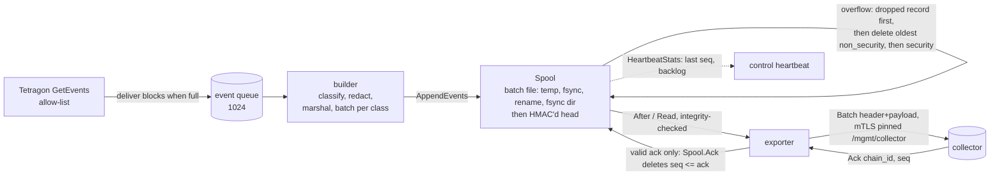

# Step 7a report: 6b close-out (Part A) and the agent's telemetry pipeline (Part T)

Prompt: `docs/prompts/step-07a.md`. Review: `docs/reviews/step-06b-review.md`.
Base: `24dfd7e` (step 6b accepted). Date: 2026-11-27.

## 1. Summary

**Definition of done met for every functional commit:** ci, integration and e3 are green
on GitHub for `ba4ae68` (run 46008210639), the last commit with code or CI changes, with
S1–S13, T-S1–T-S5 and the job-wide NO_SIGSYS check passing (first green on `cead125`,
run 46003257875). The commit adding the final progress line is docs only.

Part A closes every 6b review item. Part T builds the agent half of the telemetry
pipeline end to end: Tetragon `GetEvents` → redaction → per-class batches → a
hash chain in an HMAC'd, crash-safe spool → our own gRPC `Collector.Export` over mTLS
pinned to the collector SPIFFE ID → acks that can only delete what was really sent.

| Item | Status | Commits |
| --- | --- | --- |
| A1 R6B-1/R6B-2: `STATUS_UNSPECIFIED = 0`, new statuses and alert kinds, ADR 0037, contract, no-unspecified test | done | `6bc2b62`, `8d23954` (baseline) |
| A2 R6B-3: outbox bounds per class | done | `df66c66` |
| A3 R6B-4: cross-scope supersede rule in server-contract 10.2 | done | `7b21373` |
| A4 R6B-5: tampered mode, ADR 0038, E3 S13 | done; S13 PASS (run 45995632161) | `c1e7ff1`, `54b5809` |
| A5 E3 S1–S13 green | done (run 45995632161) | — |
| T1 ADR 0039, `relay.telemetry.v1`, docs/telemetry-contract.md | done | `ed78f03` |
| T2 `internal/telemetry`: ingest, redact, enrich, batch, chain, spool, export; relayd; heartbeat | done | `22bdd1b`, `abcc2c9`, `aa9f137`, `362dba7` |
| T3 reference chain verifier with table tests | done | `e10484b` |
| T4 fuzz targets (header, batch file, verifier) in fuzz-short and nightly | done | `b26100d` |
| T5 crash matrix, overflow, redaction, hostile ack, resend; coverage ≥ 90 %; benchmark | done; `internal/telemetry` 93.0 % | `aa9f137`, `b26100d` |
| E3 T-S1–T-S5 | done; all PASS (run 46003257875) | `cead125` |

The four Part T design points raised at the start were confirmed by the architect before
T1 (all as recommended): `Ack{chain_id, seq}` with acks cumulative per chain and old
chains drained first; `dropped` records list `(chain_id, seq, hash)` per dropped batch;
enrichment in the header (`agent_version`, `epochs`); when only security batches are
left, the oldest security batches are dropped. They are ADR 0039 section 4.

## 2. Files added or changed (since `24dfd7e`, generated code excluded)

```
.github/workflows/ci.yml                 e3: build e3collector; S1-S13, T-S1-T-S5; usrmerge note (review Q3)
.github/workflows/nightly-fuzz.yml       three telemetry fuzz targets
.golangci.yml                            depguard: telemetry <-> control path separation
Makefile                                 PROTO_BASELINE; coverage gate adds telemetry, spiffetls; fuzz-short
api/relay/control/v1/control.proto       STATUS_UNSPECIFIED=0, APPLIED=10, new statuses and alert kinds
api/relay/telemetry/v1/telemetry.proto   new: Collector.Export(stream Batch) returns (stream Ack)
cmd/e3collector/main.go                  new (e3): mTLS collector + reference verifier; serve / report
cmd/e3controller/{main,stream6b,tampered}.go   tampered mode (S13); heartbeat telemetry fields in logs
cmd/relayd/main.go                       tampered-mode branch; telemetry start
cmd/relayd/session.go                    Hello without a StartupResult (tampered mode)
cmd/relayd/tampered.go                   new: runTampered, best-effort REVOKED marker
cmd/relayd/telemetry.go                  new: startTelemetry, adapters (auditor, read-only event source)
cmd/testenroll/main.go                   optional collector certificate
docs/decisions/0037..0039                new ADRs
docs/server-contract.md                  statuses, outbox bounds, supersede rule, revocation, tampered mode (10.6)
docs/telemetry-contract.md               new: backend team's collector contract
internal/agent/{state,session,controlloop,snapshot,outbox,bundle,applyworker,trustupdate}.go
internal/agent/tampered.go               new: TamperedJobs, TamperedSnapshotProvider, TamperedConnected, BestEffortRevocations
internal/config/{schema,validate,errors}.go   event_types; argv patterns add-only; keep_env: true refused
internal/controlclient/{tlsconfig,errors}.go  use internal/spiffetls
internal/limits/limits.go                outbox class bounds; telemetry bounds
internal/spiffetls/                      new: ADR 0031's VerifyConnection, shared
internal/telemetry/                      new: pipeline, redact, spool, export, fs
internal/telemetry/batch/                new: wire format (+ batchtest for tests)
internal/telemetry/chainverify/          new: reference verifier
internal/tetra/client.go                 StreamEvents (allow-list, blocking deliver)
internal/tpm/signer.go                   LoadHostSigner (never creates a key)
scripts/e3-run.sh                        S13, T-S1..T-S5, job-wide NO_SIGSYS
```

## 3. Command output

Local (macOS; Linux-only paths are proven on GitHub):

```
$ GOOS=linux golangci-lint run ./...
0 issues.
$ go test -race -count=1 -cover ./internal/telemetry/...
ok   internal/telemetry               coverage: 93.0% of statements
ok   internal/telemetry/batch         coverage: 99.1% of statements
ok   internal/telemetry/chainverify   coverage: 93.5% of statements
$ go test -count=1 -cover ./internal/spiffetls/ ./internal/controlclient/
ok   internal/spiffetls       coverage: 96.4% of statements
ok   internal/controlclient   coverage: 97.4% of statements
$ go test -run=NONE -fuzz=FuzzBatchHeader -fuzztime=20s ./internal/telemetry/batch
fuzz: elapsed: 21s, execs: 962258, new interesting: 181 (total: 185)  PASS
$ go test -run=NONE -fuzz=FuzzSpoolFile -fuzztime=20s ./internal/telemetry
fuzz: elapsed: 21s, execs: 1377738, new interesting: 219 (total: 221) PASS
$ go test -run=NONE -fuzz=FuzzChainVerify -fuzztime=20s ./internal/telemetry/chainverify
fuzz: elapsed: 21s, execs: 155886, new interesting: 261 (total: 263)  PASS
$ make breaking
buf breaking --against ".git#ref=6bc2b62c8aa31685b61e351bc42c4bb33f33367e"
```

Local `make ci` at the start of the step: everything passed except `vuln` (govulncheck
not on the plain PATH of that shell) and `coverage90` for `internal/tetra` (86.9 %:
its Linux-only files do not build on macOS). Both are green on GitHub (ci job).

## 4. Mapping: item → functions → tests

| Item | Functions | Tests |
| --- | --- | --- |
| A1 | `applyResultMessage` (only wrapper; coerces unset/unknown to APPLY_FAILED); `SubmitBundle`, `processBundle`, `mapApplyOutcome`, `processTrustUpdate` | `TestApplyResult_NoPathSendsStatusUnspecified`, `TestApplyResult_OnlyWrappedByApplyResultMessage` (source scan of internal/ and cmd/), updated applyworker tests |
| A2 | `Outbox.Push/removeOldestLocked/Pop` | `TestOutbox_AlertsNeverEvictApplyResults`, `TestOutbox_ApplyResultBoundDropsOldestResultAndAudits`, `TestOutbox_BoundDropsOldestAndCounts` |
| A4 | `StateTampered`, `EventStoreTampered`; `TamperedJobs`, `TamperedSnapshotProvider`, `TamperedConnected`, `BestEffortRevocations`; `fireConnected`/`fireStreamLost`/RotateIdentity guards; `runTampered`, `markRevokedBestEffort`; `tpm.LoadHostSigner` | `TestRunSession_TamperedMode`, `TestStateMachine_TamperedHasNoExitButRevoked`, `TestTamperedJobs_RejectEverything`, `TestTamperedSnapshotProvider_EmptyEpochs`, `TestLoadHostSigner_MissingBlobIsErrorAndCreatesNothing`; E3 S13 |
| T1/wire | `batch.Header.Marshal/Validate`, `ParseHeader`, `HashOf`, `Parse`, `Dropped`, `Reset`, `AppendRecord`, `SplitRecords` | `batch_test.go` (canonical form, 15 non-canonical rejections, validation, hash vector), `FuzzBatchHeader` |
| T2 ingest | `tetra.Client.StreamEvents`, `Pipeline.ingest` (bounded queue, blocking deliver) | `TestClient_StreamEvents`, `TestPipeline_ConfigAndIngestReconnect` |
| T2 redact | `Redactor.Redact/walk/redactArgv`, `HashPath` | `TestPipeline_EndToEndRedactedChainedAcked`, `TestRedactor_AncestorsAndLists`, `TestRedactor_MapsAndLists`; E3 T-S1 |
| T2 batch/enrich | `Pipeline.build`, `ClassOf` | end-to-end test, `TestClassOf` |
| T2 chain/spool | `OpenSpool`, `appendLocked`, `writeHead`/`readHead`, `seal`/`unseal`, `makeRoomLocked`, `Ack`, `After`, `Read`, `DeriveSpoolKey` | `spool_test.go`, `TestSpool_CrashMatrix`, `FuzzSpoolFile` |
| T2 export | `exporter.run/session`, `ackState.check`, `sendBounded`, `GRPCDialer` | `TestExporter_AckRules`, `TestPipeline_HostileAckDeletesNothingAndResends`, `TestPipeline_OutageSpoolsThenDrainsInOrder`, `TestExporter_StalledCollectorIsBounded`, `TestGRPCDialer_MTLSPinnedEndToEnd` |
| T2 heartbeat | `ControlLoop.Telemetry`, `Pipeline.HeartbeatStats` | `TestBuildHeartbeat_TelemetryFields` |
| T2 separation | depguard rules; `spiffetls.ClientTLSConfig/VerifyConnection` | lint (probed both directions, section 6 item 9); `spiffetls_test.go` |
| T3 | `chainverify.Verifier.Add/Gaps/Chains`, `Verify`, `Report.Clean` | `TestVerify_Table` (gap, gap at start, reorder, duplicate, duplicate mismatch, fork two ways, reset, boot change, wrong prev head, boot mismatch, declared drops, lying drop record, bad header, hash mismatch), plus 6 more; `FuzzChainVerify` |
| T5 bench | — | `BenchmarkPipeline5k` |

## 5. Invariants and threats addressed

- **An unset ApplyResult status can never read as success** (R6B-1): proto zero value is
  `STATUS_UNSPECIFIED`, the agent never sends it, and the contract says unknown means
  not applied.
- **A TAMPERED host is not silent** (R6B-5) and still cannot change anything: tampered
  mode builds no apply engine, worker or scheduler (no Tetragon writes by construction),
  and never reads the REVOKED marker as "not revoked".
- **Telemetry completeness is provable from the spool on** (architecture 10.3): every
  batch commits to its predecessor; a batch above the persisted head is never sent; a
  drop is declared (with hashes) before the files are deleted, so even a crash mid-drop
  leaves no undeclared hole (crash matrix, overflow case).
- **The collector can only acknowledge** (architecture 10): an ack for another chain, a
  seq never sent on the stream, or a regressing ack closes the stream and deletes
  nothing (unit test and T-S5).
- **Spool integrity**: every batch file is HMAC-SHA-384'd with a key derived from the
  store key (HKDF), over the file name too, so a renamed, edited or foreign file is
  dropped, counted, audited and never sent.
- **Separation** (architecture 10.2): telemetry cannot import the control path or the
  Tetragon client (it gets a read-only `EventSource`); the control path cannot import
  telemetry; the telemetry dialer pins the collector SPIFFE ID with the shared ADR 0031
  verification.
- **A collector outage never restarts relayd**: Send and Dial are bounded; every
  telemetry loop touches liveness on its own ticker (T-S2 checks `NRestarts=0`).
- **Redaction before anything is spooled**: environment dropped in every `Process`
  (including parent and ancestors), argv pattern matches replaced, `/home/*/.ssh` paths
  hashed anywhere in the event (reflection walk); config can only add patterns.

## 6. Deviations from this prompt or the architecture

1. **PROTO_BASELINE in the following commit.** A commit cannot name its own SHA, so
   `8d23954` advances the baseline to `6bc2b62`, pushed together, as step 2 did.
2. **ROLLBACK_FAILED raises two alerts**, `ROLLBACK_FAILED` and `DRIFT` (the review's
   table says the DRIFT alert stays and adds the new kind).
3. **Outbox class bounds are fixed** (ApplyResults 16, alerts 48), not "the remainder"
   computed dynamically; the total stays ≤ 64.
4. **Tampered mode refuses RotateIdentity** ("connects with the identity as it is"), and
   uses `tpm.LoadHostSigner`, which never creates a key. With no key or chain it does not
   connect.
5. **Best-effort REVOKED marker** re-opens the store only to call `MarkRevoked`. If the
   index is what was tampered, Open fails again and nothing is written (audited).
6. **Telemetry runs in tampered mode too**, on a new chain (`tampered_mode`) with empty
   epochs; it never reads the store.
7. **Telemetry starts only when an identity exists** (like the session). A production
   build with no Enroller stays UNENROLLED and runs no telemetry.
8. **`keep_env: true` is now a config error** (`ErrKeepEnvUnsupported`): the prompt says
   the environment is dropped, and a relaxation must come from signed metadata (7b).
   `redaction.argv_patterns` now only adds to the built-in set (it used to replace it).
9. **depguard is stricter than asked**: `internal/telemetry` also may not import
   `internal/agent` (whole package, not only the apply-worker files, which depguard cannot
   express), `internal/tetra` and `internal/store`. Both directions were probed: an import
   of `internal/apply` from telemetry and of telemetry from `internal/agent` each fail
   lint.
10. **Argv redaction applies the patterns to the whole `arguments` string**, so a pattern
    spanning a space (`--password secret`, the built-in default) works; tokens that are
    `~/.ssh` paths are hashed. "Tokens that match" alone would miss the default pattern.
11. **The spool cap is soft for control batches**: dropped and chain_reset records are
    never dropped; if only control batches are left and still over the cap, the new
    events batch is refused (`ErrSpoolFull`, audited, events counted as lost).
12. **Tetragon lost-event count**: the v1.8.0 API exposes `RateLimitInfo`
    (`number_of_dropped_process_events`), which is counted and audited. I found no API
    field for events a slow client misses, and the vendored stubs do not show whether
    Tetragon drops or blocks for a slow client; that behaviour is unverified.
13. **T-S4's drop-in** points ExecStart at a copy of relay.yaml that differs only in
    `collector.spool_max_bytes: 524288` (512 KiB). relayd takes its config only from
    `--config`, so "a drop-in setting only spool_max_bytes" is that.
14. **T-S1 and the environment**: E3's Tetragon runs with no flag that populates
    `environment_variables`, and I could not verify which v1.8.0 flag would, so T-S1
    shows `env=0` and that no secret from the canary's environment reached the
    collector; dropping a populated environment is proven by unit tests.
15. **Commit size**: `aa9f137` (telemetry core plus its tests) and `cead125` (e3collector
    plus five scenarios) exceed ~400 lines; the spool, exporter and pipeline do not build
    or test apart.

## 7. Dependencies added

None. HKDF is the standard library's `crypto/hkdf`; gRPC and protobuf were already
vendored.

## 8. Known limitations

- **Benchmark misses the CPU target** (section 13): about 8 % of a core at 5k events/s
  against architecture 8.13's < 1 %. Not a gate in 7a. Compression and batching
  optimizations are 7b decisions, to be measured.
- Events read from Tetragon but not yet spooled when relayd crashes are lost without a
  trace in the chain (ADR 0039, consequences).
- The verifier keeps every `(chain, seq)` it has seen (bounded at 2^20 entries); a
  production collector needs pruning below the contiguous head.
- `dropped` records in a long outage accumulate (they are never dropped). They are small
  (one per make-room) but unbounded in principle.

## 9. Open questions for the architect

1. **CPU at 5k events/s** is ~8× over target in the benchmark. Is the 1 % target meant for
   the whole pipeline including fsync and HMAC, and should 7b prioritize cheaper
   redaction (field-specific instead of reflection) or larger batches?
2. **Telemetry without an identity**: should an UNENROLLED host spool locally (to send
   after enrollment), or is "no telemetry until enrolled" correct?
3. **Collector-side pruning and the gap grace period** (contract section 4) need numbers
   from the backend team.

## 10. Self-review: the 5 places a reviewer is most likely to find a bug

1. **Exporter dial/stream contexts** (`exporter.session`). gRPC binds a stream to the
   context it was opened with; an early version canceled the dial timeout context and
   killed every stream (caught by the pipeline tests). The dial timeout now cancels the
   session context instead.
2. **Overflow ordering** (`makeRoomLocked`). The dropped record is appended (file then
   head) before the victims are deleted; a crash in between leaves victims on disk and
   declared, which the verifier accepts (declared and received with the same hash). The
   crash matrix covers every operation of this path.
3. **Orphan rule in `OpenSpool`**: files of a newer generation, or of the head's
   generation with another chain or a seq above the head, are deleted. If the head itself
   is missing or corrupt, no file can be called an orphan, so every intact file is kept
   and sent; a new chain starts at `max gen + 1`.
4. **Ack validation per stream** (`ackState`). A collector that acks a seq it received on
   a previous stream, before the agent resends it on this one, is treated as hostile.
   The contract says to ack only what was received on the current stream.
5. **Tampered-mode state guards**: RunSession fires no connection transitions in TAMPERED
   (`fireConnected`, `fireStreamLost`); `CheckCertExpiry` has no edge from TAMPERED; an
   added transition from TAMPERED would silently change that.

## 11. The telemetry pipeline as built

Goroutines (all started by `Pipeline.Run`; each is a liveness component with a 60 s
bound, touched every 5 s by its own loop, never by collector reachability):

| Goroutine | Does | Bounded by |
| --- | --- | --- |
| `telemetry_ingest` | keeps one `GetEvents` stream (allow-list from `collector.event_types`) open; reconnects with backoff 1–30 s | the event queue: 1024 events; `deliver` blocks when it is full, so Tetragon is read no faster than the pipeline spools |
| (stream reader) | `tetra.StreamEvents` Recv loop | — |
| `telemetry_builder` | `RateLimitInfo` → counter; classify; redact; deterministic marshal; per-class batch; flush at 2000 events, 1 MiB payload or 2 s; `Spool.AppendEvents` | event ≤ 256 KiB; payload ≤ 1 MiB; spool cap |
| `telemetry_exporter` | one Export stream at a time; sends every spooled batch in order (oldest chain first), then each new one; validates acks; deletes on a valid ack | Send ≤ 20 s, Dial ≤ 10 s, then the stream is canceled; backoff 1–30 s |
| (ack reader) | Export Recv loop → bounded ack channel (64) | — |



## 12. E3 evidence for S13 and T-S1 to T-S5

All from the e3 job of the run named, under the real unit with the documented drop-ins
only. Each scenario's script assertions are in `scripts/e3-run.sh`; below are the log
lines they rest on.

```
run 46003257875 (cead125):
E3 RESULT: S1..S12 PASS   E3 RESULT: T-S1 PASS  T-S2 PASS  T-S3 PASS  T-S4 PASS  T-S5 PASS
E3 RESULT: S13 PASS       E3 RESULT: S4 PASS    E3 RESULT: NO_SIGSYS PASS
```

**S13 (tampered mode)**, run 45995632161 (`54b5809`), repeated green in 46003257875. One
hex digit of the index HMAC changed with relayd stopped:

```
e3controller: [12:33:01Z] conn #1 seq=2 Alert kind=TAMPER detail="store TAMPERED at startup; tampered mode (...): store: tampered: HMAC mismatch"
e3controller: Alert TAMPER OK (first message after HelloAck)
e3controller: [12:33:16Z] conn #1 seq=3 heartbeat epochs=map[] loaded_digest=439353ac...
e3controller: [12:33:31Z] conn #1 seq=4 heartbeat epochs=map[] loaded_digest=439353ac...
e3controller: [12:33:31Z] conn #1 seq=5 ApplyResult status=REJECTED_TAMPERED epoch=0 bundle_digest=d9040ebd... loaded_digest_after=
e3controller: [12:33:31Z] conn #1 seq=6 Alert kind=TRUST_UPDATE_REJECTED detail="store TAMPERED at startup: tampered mode, ..."
loaded before: e3-admin-kill-v1-6c08f7fd,e3-baseline
loaded after:  e3-admin-kill-v1-6c08f7fd,e3-baseline
relayd-e3[5485]: {"step":"tampered_mode","detail":"store TAMPERED at startup: tampered mode (no Tetragon writes, no store writes, ...)"}
S13 NRestarts=0
E3 RESULT: NO_SIGSYS PASS        (whole job: no status=31/SYS)
```

**T-S1 (valid chain; canary redacted).** The canary ran
`E3_SECRET_ENV=e3-env-secret sh -c 'cd /home/e3canary/.ssh && /usr/bin/cat /home/e3canary/.ssh/id_e3 --password=hunter2 token=e3tok'`.
The collector's report (`e3collector report --decode`):

```
REPORT   event *tetragon.GetEventsResponse_ProcessExec binary="/usr/bin/cat" arguments="sha256:191dca91...f96e9e [REDACTED] [REDACTED]" env=0 cwd="sha256:e5a24117...6a25de" args=[]
REPORT   event *tetragon.GetEventsResponse_ProcessKprobe binary="/tmp/e3-baseline-placeholder" arguments="-c \"/usr/bin/true; /usr/bin/true\"" env=0 ...
REPORT chain 2e071b0cf92eda7cc3217aa393c62b02 boot="485e6509-..." contiguous=4 max=4 received=4 declared_dropped=0 reset=head_missing
REPORT CLEAN: 4 batches, 1 chain(s), no gap, fork or bad batch
e3controller: heartbeat 1/3 ... telemetry_last_seq=4 telemetry_backlog=0
```

No line of the report contains `hunter2`, `e3tok`, `/home/e3canary/.ssh` or
`e3-env-secret`, and no event has `env>0` (script greps). See deviation 14 on the
environment.

**T-S2 (30 s collector outage).**

```
T-S2 spool batches: before outage=0 after 30 s down=23
e3controller: heartbeat 1/4 ... telemetry_last_seq=15 telemetry_backlog=11
e3controller: heartbeat 2/4 ... telemetry_last_seq=27 telemetry_backlog=23
e3controller: heartbeat 3/4 ... telemetry_last_seq=29 telemetry_backlog=0
REPORT chain 2e071b0c... contiguous=29 max=29 received=29 declared_dropped=0 reset=head_missing
REPORT CLEAN: 29 batches, 1 chain(s), no gap, fork or bad batch
```

The spool emptied (`wait_spool_empty`), there was no `chain_reorder` or `chain_gap`,
relayd stayed active with `NRestarts=0`, and the journal shows `telemetry_stream_ended`
during the outage.

**T-S3 (relayd restart mid-stream).** `systemctl restart` while events flowed; the
journal has `telemetry_chain_continued` (script check) and the collector still sees one
chain, contiguous across the restart:

```
REPORT chain 2e071b0cf92eda7cc3217aa393c62b02 ... contiguous=33 max=33 received=33 declared_dropped=0 reset=head_missing
REPORT CLEAN: 33 batches, 1 chain(s), no gap, fork or bad batch
```

**T-S4 (tiny spool cap, 512 KiB).** The second drop-in points at a copy of relay.yaml
whose only difference is `spool_max_bytes: 524288` (the `diff` output is in the log).
Collector down for 43 s of events:

```
T-S4 spool: 32 batches, 516924 bytes
verdict=dropped(class=non_security count=1)   x14
verdict=dropped(class=non_security count=2)   x4
REPORT chain 6a1ce39d7fd82de35e53e3b41e9c4c9e ... contiguous=50 max=50 received=39 declared_dropped=11 reset=head_missing
REPORT CLEAN: 39 batches, 1 chain(s), no gap, fork or bad batch
```

No `dropped(class=security` record, and the decoded report holds `ProcessKprobe`
events (security survived). Every hole is declared, so the chain is contiguous.

**T-S5 (hostile ack).**

```
e3collector: [13:30:37.0697Z] stream #1 from host 11111111-...
e3collector: [13:30:37.0704Z] stream #1 batch {...,"seq":1,...}
e3collector: [13:30:37.0704Z] HOSTILE ack chain=35a3a433... seq=1001 (only seq 1 was sent)
e3collector: [13:30:37.0707Z] stream #1 ended: EOF
e3collector: [13:30:38.0891Z] stream #2 from host 11111111-...
e3collector: [13:30:38.0897Z] stream #2 batch {...,"seq":1,...}
REPORT CLEAN: 10 batches, 1 chain(s), no gap, fork or bad batch
```

relayd closed the stream within a millisecond, audited `telemetry_protocol_error`
(script check), reconnected after its 1 s backoff and resent seq 1: the batch the
hostile ack claimed was still spooled, so nothing was deleted early.

## 13. Benchmark against architecture 8.13

`BenchmarkPipeline5k` (`go test -run=NONE -bench=Pipeline5k -benchtime=50000x`), the
whole pipeline on a realistic exec event (process, parent and one ancestor; ~1 KiB
marshaled), with a real HMAC'd, fsynced spool and an in-memory collector that discards:

```
cpu: Apple M2 Pro
BenchmarkPipeline5k-10  50000  42176 ns/op  8.383 %core@5k/s  16766 cpu-ns/event  47.24 go-sys-MiB  53.34 maxrss-MiB
BenchmarkPipeline5k-10  50000  42065 ns/op  8.418 %core@5k/s  16836 cpu-ns/event  51.24 go-sys-MiB  54.75 maxrss-MiB
```

| Metric | Target | Measured | Note |
| --- | --- | --- | --- |
| CPU at 5k events/s | < 1 % of one core | ~8.4 % (upper bound) | process CPU (getrusage) minus the cost of building the input events; includes GC and the in-process collector. A CPU profile attributes ~20 % of samples to the pipeline's own functions (spool writes, redaction walk) and most of the rest to GC and the benchmark harness. |
| RSS | < 64 MiB | 53–55 MiB max RSS of the whole test process | includes the Go test runtime and 4096-event input buffer |
| Spool capacity | 2 GiB ≈ 8 h at 5k events/s | not measured (no compression in 7a) | ~1 KiB/event uncompressed is ~18 GB per 8 h: 2 GiB holds ~55 min at 5k/s without compression |

Not a gate in 7a; numbers recorded for 7b's compression decision.

## Progress log

One dated line per push: commit, what changed, the CI result observed.

- 2026-11-27 `54b5809` (with `e4db31d` prompt/review, `6bc2b62`/`8d23954` A1, `df66c66` A2, `7b21373` A3, `c1e7ff1` A4): run 45995632161: ci ✓, integration ✓, e3 ✓. **S1–S13 PASS, NO_SIGSYS PASS.** S13: TAMPER first, empty-epochs heartbeats, REJECTED_TAMPERED, TRUST_UPDATE_REJECTED, loaded set unchanged, NRestarts=0.
- 2026-11-27 `e10484b` (with `ed78f03` T1, `22bdd1b` wire format): run 46000266649: ci ✓, integration ✓, e3 ✓ (S1–S13; no telemetry wired yet).
- 2026-11-27 `cead125` (with `abcc2c9` spiffetls/StreamEvents, `aa9f137` telemetry core, `362dba7` relayd wiring): run 46003257875: ci ✓, integration ✓, e3 ✓. **S1–S13 and T-S1–T-S5 PASS, NO_SIGSYS PASS**, first attempt.
- 2026-11-27 `ba4ae68` (with `b26100d` fuzz targets and benchmark; report): run 46008210639: ci ✓ (fuzz-short with the three telemetry targets, coverage gate with internal/telemetry and internal/spiffetls), integration ✓, e3 ✓. **S1–S13, T-S1–T-S5 and NO_SIGSYS PASS** again on the final code commit.
- 2026-11-27 `eaa6c0b` (progress log for ba4ae68, docs only): run 46013547920: ci ✓, integration ✓, e3 ✓. S1–S13 and T-S1–T-S5 PASS again on the final commit.
